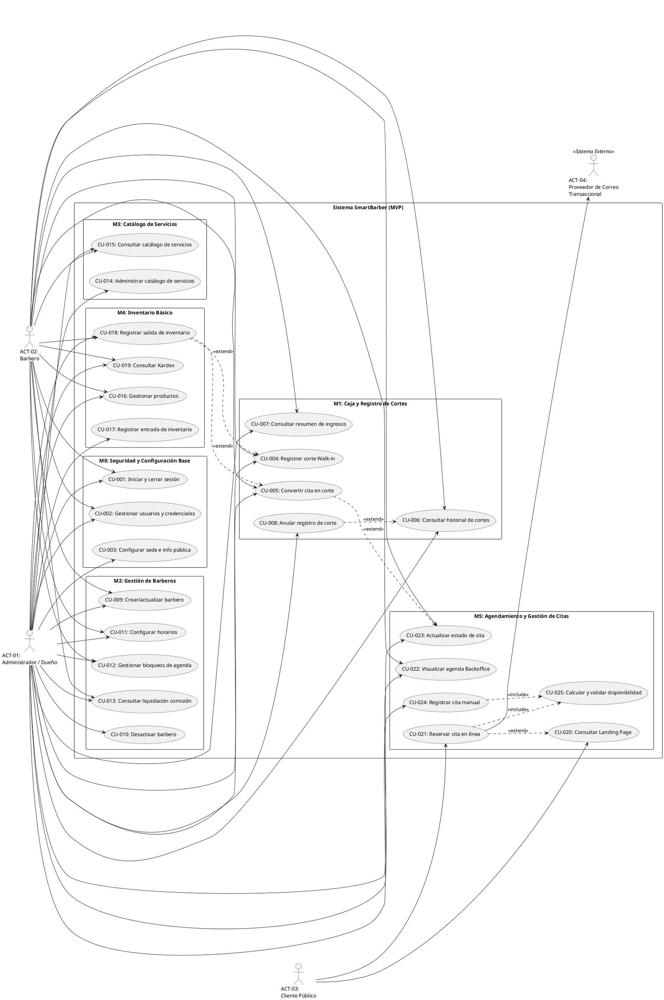
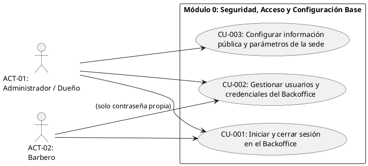
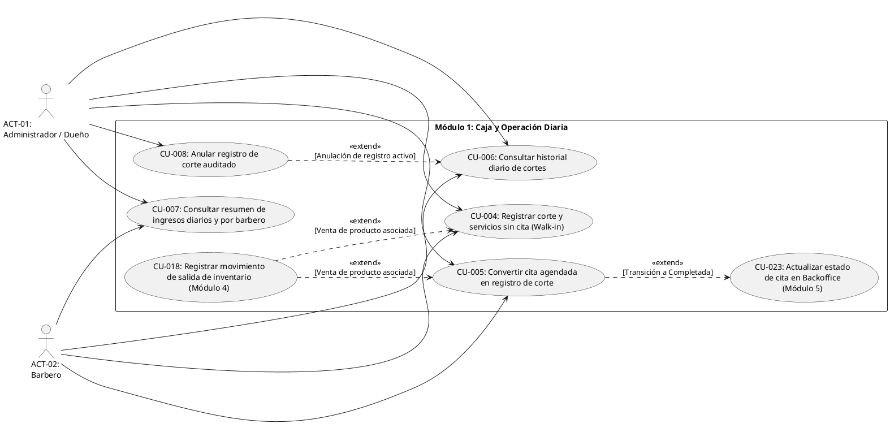
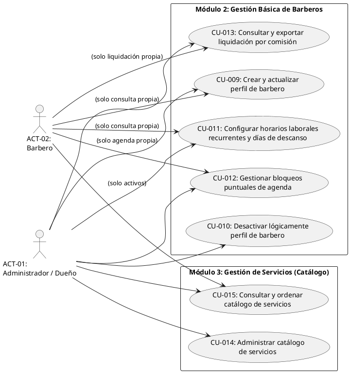
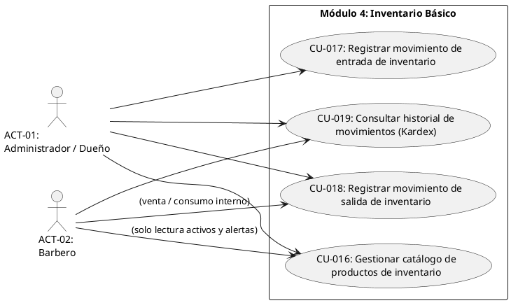
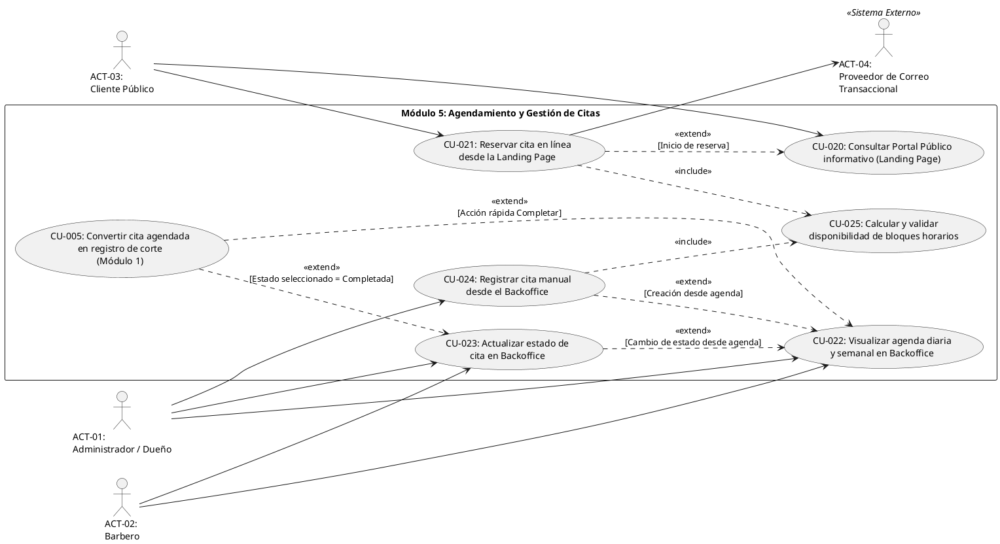

# Documento Formal de Especificación de Casos de Uso — SmartBarber

## 1. Información General del Documento

### 1.1 Metadatos del Documento

| Campo | Detalle |
| :--- | :--- |
| **Proyecto** | SmartBarber — Sistema de Gestión Operativa y Agendamiento para Barbería |
| **Versión del documento** | 1.0 |
| **Fecha de emisión** | 20 de noviembre de 2026 |
| **Basado en ERS** | `ers_smartbarber.md` — Especificación de Requerimientos de Software (ERS) SmartBarber, Versión 1.0 (2026-11-20) |
| **Estándares aplicados** | ISO/IEC/IEEE 29148:2018, UML 2.5, Formato *Fully Dressed* (Alistair Cockburn) |
| **Rol responsable** | Analista de Sistemas Principal / Ingeniero de Requisitos Senior |
| **Moneda y zona horaria base** | Peso Colombiano (COP, valores enteros $\ge 0$) / UTC-5 (`America/Bogota`) |

### 1.2 Propósito y Alcance

El presente documento especifica de manera formal, detallada, agnóstica a la interfaz gráfica y libre de ambigüedades el comportamiento funcional de **SmartBarber** a través de casos de uso a nivel de **Objetivo de Usuario**, garantizando una trazabilidad bidireccional del $100\%$ frente a los Requerimientos Funcionales (`RF`), Reglas de Negocio (`RN`) y Requerimientos No Funcionales (`RNF`) interactivos establecidos en la ERS v1.0.

El alcance cubre integralmente el Producto Mínimo Viable (MVP) de sede única (con estructura preparada para multi-sede), abarcando seis (6) paquetes funcionales:
1. **Módulo 0 — Seguridad, Acceso y Configuración Base (Transversal):** autenticación del Backoffice, administración de usuarios/credenciales y configuración de la información pública y parámetros de la sede.
2. **Módulo 1 — Registro de Cortes y Servicios Realizados (Caja / Operación Diaria):** atenciones *walk-in*, conversión de citas a registros de corte, consulta de historial, resumen de ingresos y anulación auditada.
3. **Módulo 2 — Gestión Básica de Barberos:** perfiles de barberos, desactivación lógica, horarios recurrentes, bloqueos puntuales y liquidación referencial por comisiones.
4. **Módulo 3 — Gestión de Servicios (Catálogo):** administración de servicios por bloques de $30$ minutos, activación/desactivación, preservación histórica de precios y consulta ordenada.
5. **Módulo 4 — Inventario Básico:** gestión de productos al por menor, entradas, salidas por venta/consumo interno, alertas de stock bajo/agotado e historial de movimientos (Kardex).
6. **Módulo 5 — Portal Público de Agendamiento y Gestión de Citas:** Landing Page pública informativa, reserva en línea en $5$ pasos, agenda diaria/semanal, ciclo de vida de citas, registro manual de citas y motor compartido de disponibilidad horaria.

Quedan **fuera de alcance** todos los elementos excluidos explícitamente en la Sección 1.2 de la ERS: pasarelas de pago en línea, facturación electrónica DIAN, notificaciones automatizadas por WhatsApp API/SMS, cuentas autenticadas para clientes finales, operación multi-sede en interfaz, gestión de compras a proveedores/lotes y aplicaciones móviles nativas.

### 1.3 Convenciones de Nomenclatura

| Prefijo / Patrón | Significado | Ejemplo |
| :--- | :--- | :--- |
| `ACT-XX` | Identificador único de Actor (primario o externo/secundario) | `ACT-01` |
| `CU-XXX` | Identificador único de Caso de Uso | `CU-001` |
| `RF-MMM-XX` | Requerimiento Funcional de la ERS (`COR`, `BAR`, `SER`, `INV`, `AGE`) | `RF-COR-01` |
| `RN-XX` | Regla de Negocio de la ERS | `RN-01` |
| `RNF-XX` | Requerimiento No Funcional de la ERS | `RNF-09` |
| `FA-XX` | Flujo Alternativo dentro de un caso de uso | `FA-01` |
| `FE-XX` | Flujo de Excepción (error o validación) dentro de un caso de uso | `FE-01` |
| `[Supuesto]` | Paso de control o comportamiento inferido que no está detallado explícitamente en la ERS y se audita en la Sección 7 | `[Supuesto]` |

---

## 2. Catálogo de Actores

| ID | Nombre del Actor | Tipo | Descripción y Responsabilidades | Herencia / Relación con otros actores |
| :--- | :--- | :--- | :--- | :--- |
| **ACT-01** | Administrador / Dueño | Primario | Usuario autenticado del Backoffice con control global (`G`) sobre la sede, credenciales de acceso, perfiles y horarios de barberos, catálogo de servicios, inventario, agenda general, registro y anulación de cortes, ajustes manuales de precio y reportes consolidados. Puede también operar como barbero si cuenta con un perfil de barbero asociado y consultar o probar el portal público como usuario web. | Sin herencia formal en UML (no todo Administrador posee necesariamente un perfil operativo de barbero y su ámbito es global frente al ámbito propio del Barbero). |
| **ACT-02** | Barbero | Primario | Usuario autenticado del Backoffice con permisos restringidos a su operación diaria: gestión de su propia contraseña, consulta de su perfil y horarios, registro de bloqueos en su propia agenda, consulta y actualización de estado de sus propias citas, conversión de citas a cortes, registro de atenciones *walk-in* propias, consulta de sus ingresos y comisiones, consulta de catálogo activo e inventario y registro de salidas de inventario por venta o consumo interno. | Sin herencia formal en UML. Comparte la interfaz de autenticación y varios casos de uso del Backoffice con `ACT-01`, diferenciados mediante reglas de autorización RBAC (`P` vs `G`). |
| **ACT-03** | Cliente Público | Primario | Usuario no autenticado que accede al Portal Público (Landing Page) desde navegador web (enfoque *Mobile-First*) para consultar la información comercial, catálogo de servicios y barberos activos, así como reservar citas en tiempo real sin crear cuenta ni iniciar sesión. | Ninguna. |
| **ACT-04** | Proveedor de Correo Transaccional | Sistema Externo (Secundario) | Servicio externo de mensajería electrónica integrado de forma asíncrona con el núcleo de negocio de SmartBarber para recibir solicitudes de despacho y entregar correos de confirmación de citas (con código único `SB-XXXXXX`, detalles de la reserva y política de cancelación) al correo del Cliente Público. | Ninguna. |

---

## 3. Resumen Ejecutivo de Casos de Uso (Catálogo Maestro)

### Módulo 0: Seguridad, Acceso y Configuración Base (Transversal)

| ID | Nombre del Caso de Uso | Módulo | Actor(es) | Prioridad | Complejidad | Requisitos ERS Asociados (RF/RNF/RN) |
| :--- | :--- | :--- | :--- | :--- | :--- | :--- |
| **CU-001** | Iniciar y cerrar sesión en el Backoffice | Seguridad y Configuración Base | `ACT-01`, `ACT-02` | Alta | Media | `RNF-09`, `RNF-10`, `RNF-12`, `RNF-15`, `RNF-16` *(Secc. 2.2 y 6)* |
| **CU-002** | Gestionar usuarios y credenciales del Backoffice | Seguridad y Configuración Base | `ACT-01`, `ACT-02` | Alta | Media | `RF-BAR-01`, `RF-BAR-02`, `RNF-03`, `RNF-09`, `RNF-10`, `RNF-12`, `RNF-15` *(Secc. 2.2)* |
| **CU-003** | Configurar información pública y parámetros de la sede | Seguridad y Configuración Base | `ACT-01` | Media | Baja | `RF-AGE-01`, `RN-03`, `RNF-03`, `RNF-10`, `RNF-12`, `RNF-15` *(Secc. 2.2 y 6)* |

### Módulo 1: Registro de Cortes y Servicios Realizados (Caja / Operación Diaria)

| ID | Nombre del Caso de Uso | Módulo | Actor(es) | Prioridad | Complejidad | Requisitos ERS Asociados (RF/RNF/RN) |
| :--- | :--- | :--- | :--- | :--- | :--- | :--- |
| **CU-004** | Registrar corte y servicios sin cita (Walk-in) | Caja / Operación Diaria | `ACT-02`, `ACT-01` | Alta | Media | `RF-COR-01`, `RN-09`, `RN-12`, `RN-15`, `RNF-03`, `RNF-07`, `RNF-10`, `RNF-12`, `RNF-15` |
| **CU-005** | Convertir cita agendada en registro de corte | Caja / Operación Diaria | `ACT-02`, `ACT-01` | Alta | Alta | `RF-COR-02`, `RF-AGE-07`, `RF-SER-04`, `RN-07`, `RN-08`, `RN-12`, `RN-15`, `RNF-03`, `RNF-07`, `RNF-10`, `RNF-15` |
| **CU-006** | Consultar historial diario de cortes | Caja / Operación Diaria | `ACT-01`, `ACT-02` | Alta | Baja | `RF-COR-03`, `RN-12`, `RN-13`, `RNF-03`, `RNF-08`, `RNF-10`, `RNF-15` |
| **CU-007** | Consultar resumen de ingresos diarios y por barbero | Caja / Operación Diaria | `ACT-01`, `ACT-02` | Alta | Media | `RF-COR-04`, `RN-12`, `RN-13`, `RNF-03`, `RNF-08`, `RNF-10`, `RNF-15` |
| **CU-008** | Anular registro de corte auditado | Caja / Operación Diaria | `ACT-01` | Media | Media | `RF-COR-05`, `RN-07`, `RN-08`, `RN-13`, `RNF-03`, `RNF-10`, `RNF-15` |

### Módulo 2: Gestión Básica de Barberos

| ID | Nombre del Caso de Uso | Módulo | Actor(es) | Prioridad | Complejidad | Requisitos ERS Asociados (RF/RNF/RN) |
| :--- | :--- | :--- | :--- | :--- | :--- | :--- |
| **CU-009** | Crear y actualizar perfil de barbero | Gestión de Barberos | `ACT-01`, `ACT-02` | Alta | Media | `RF-BAR-01`, `RN-12`, `RNF-03`, `RNF-09`, `RNF-10`, `RNF-12` |
| **CU-010** | Desactivar lógicamente perfil de barbero | Gestión de Barberos | `ACT-01` | Alta | Media | `RF-BAR-02`, `RN-13`, `RNF-03`, `RNF-10`, `RNF-15` |
| **CU-011** | Configurar horarios laborales recurrentes y días de descanso | Gestión de Barberos | `ACT-01`, `ACT-02` | Alta | Media | `RF-BAR-03`, `RN-02`, `RNF-03`, `RNF-10` |
| **CU-012** | Gestionar bloqueos puntuales de agenda | Gestión de Barberos | `ACT-01`, `ACT-02` | Media | Media | `RF-BAR-04`, `RN-01`, `RN-09`, `RNF-03`, `RNF-10`, `RNF-15` |
| **CU-013** | Consultar y exportar liquidación referencial por comisión | Gestión de Barberos | `ACT-01`, `ACT-02` | Media | Baja | `RF-BAR-05`, `RN-12`, `RN-13`, `RNF-03`, `RNF-10` |

### Módulo 3: Gestión de Servicios (Catálogo)

| ID | Nombre del Caso de Uso | Módulo | Actor(es) | Prioridad | Complejidad | Requisitos ERS Asociados (RF/RNF/RN) |
| :--- | :--- | :--- | :--- | :--- | :--- | :--- |
| **CU-014** | Administrar catálogo de servicios | Gestión de Servicios | `ACT-01` | Alta | Media | `RF-SER-01`, `RF-SER-02`, `RF-SER-04`, `RN-02`, `RN-12`, `RN-13`, `RNF-03`, `RNF-10`, `RNF-12` |
| **CU-015** | Consultar y ordenar catálogo de servicios | Gestión de Servicios | `ACT-01`, `ACT-02` | Media | Baja | `RF-SER-03`, `RNF-08`, `RNF-10` |

### Módulo 4: Inventario Básico

| ID | Nombre del Caso de Uso | Módulo | Actor(es) | Prioridad | Complejidad | Requisitos ERS Asociados (RF/RNF/RN) |
| :--- | :--- | :--- | :--- | :--- | :--- | :--- |
| **CU-016** | Gestionar catálogo de productos de inventario | Inventario Básico | `ACT-01`, `ACT-02` | Alta | Media | `RF-INV-01`, `RF-INV-04`, `RN-11`, `RN-13`, `RNF-03`, `RNF-08`, `RNF-10`, `RNF-12` |
| **CU-017** | Registrar movimiento de entrada de inventario | Inventario Básico | `ACT-01` | Alta | Media | `RF-INV-02`, `RF-INV-04`, `RN-11`, `RNF-03`, `RNF-10`, `RNF-15` |
| **CU-018** | Registrar movimiento de salida de inventario | Inventario Básico | `ACT-01`, `ACT-02` | Alta | Alta | `RF-INV-03`, `RF-INV-04`, `RN-10`, `RN-11`, `RNF-03`, `RNF-08`, `RNF-10`, `RNF-15` |
| **CU-019** | Consultar historial de movimientos de inventario (Kardex) | Inventario Básico | `ACT-01`, `ACT-02` | Media | Baja | `RF-INV-05`, `RF-INV-04`, `RN-11`, `RNF-03`, `RNF-08`, `RNF-10` |

### Módulo 5: Portal Público de Agendamiento y Gestión de Citas

| ID | Nombre del Caso de Uso | Módulo | Actor(es) | Prioridad | Complejidad | Requisitos ERS Asociados (RF/RNF/RN) |
| :--- | :--- | :--- | :--- | :--- | :--- | :--- |
| **CU-020** | Consultar Portal Público informativo (Landing Page) | Agendamiento y Citas | `ACT-03` | Alta | Baja | `RF-AGE-01`, `RNF-01`, `RNF-04`, `RNF-05`, `RNF-08`, `RNF-12`, `RNF-13`, `RNF-16` |
| **CU-021** | Reservar cita en línea desde la Landing Page | Agendamiento y Citas | `ACT-03`, `ACT-04` | Alta | Alta | `RF-AGE-02`, `RF-AGE-03`, `RF-AGE-04`, `RF-AGE-05`, `RF-AGE-06`, `RF-SER-04`, `RN-01`, `RN-02`, `RN-03`, `RN-04`, `RN-05`, `RN-12`, `RN-14`, `RNF-01`, `RNF-02`, `RNF-04`, `RNF-05`, `RNF-06`, `RNF-08`, `RNF-11`, `RNF-12`, `RNF-15`, `RNF-16` |
| **CU-022** | Visualizar agenda diaria y semanal en el Backoffice | Agendamiento y Citas | `ACT-01`, `ACT-02` | Alta | Media | `RF-AGE-08`, `RN-02`, `RNF-03`, `RNF-08`, `RNF-10`, `RNF-15`, `RNF-16` |
| **CU-023** | Actualizar estado de cita en el Backoffice | Agendamiento y Citas | `ACT-01`, `ACT-02` | Alta | Alta | `RF-AGE-07`, `RN-05`, `RN-06`, `RN-07`, `RN-08`, `RN-13`, `RNF-03`, `RNF-08`, `RNF-10`, `RNF-15` |
| **CU-024** | Registrar cita manual desde el Backoffice | Agendamiento y Citas | `ACT-01` | Media | Alta | `RF-AGE-09`, `RF-SER-04`, `RN-01`, `RN-02`, `RN-04`, `RN-12`, `RNF-02`, `RNF-03`, `RNF-10`, `RNF-12`, `RNF-15` |
| **CU-025** | Calcular y validar disponibilidad de bloques horarios | Agendamiento y Citas | `ACT-03`, `ACT-01` *(vía inclusión)* | Alta | Alta | `RF-AGE-04`, `RF-AGE-09`, `RN-01`, `RN-02`, `RN-03`, `RN-04`, `RNF-02`, `RNF-04`, `RNF-15` |

---

## 4. Diagramas de Casos de Uso (UML 2.5)

Los diagramas se proveen en sintaxis **PlantUML** válida y conforme a **UML 2.5**, respetando las direcciones normativas de `<<include>>` (desde el caso de uso base hacia el incluido) y `<<extend>>` (desde la extensión hacia el caso de uso base).

### 4.1 Diagrama de Contexto General

### 4.2 Diagrama — Módulo 0: Seguridad, Acceso y Configuración Base

### 4.3 Diagrama — Módulo 1: Registro de Cortes y Servicios Realizados (Caja / Operación Diaria)

### 4.4 Diagrama — Módulo 2: Gestión Básica de Barberos y Módulo 3: Catálogo de Servicios

### 4.5 Diagrama — Módulo 4: Inventario Básico

### 4.6 Diagrama — Módulo 5: Portal Público de Agendamiento y Gestión de Citas

---

## 5. Especificación Detallada de Casos de Uso (Formato *Fully Dressed*)

### Módulo 0: Seguridad, Acceso y Configuración Base

#### CU-001: Iniciar y cerrar sesión en el Backoffice

| Campo | Detalle |
| :--- | :--- |
| **ID** | `CU-001` |
| **Módulo / Paquete** | Módulo 0: Seguridad, Acceso y Configuración Base |
| **Actor Primario** | `ACT-01` - Administrador / Dueño / `ACT-02` - Barbero |
| **Actores Secundarios** | No aplica |
| **Prioridad** | Alta |
| **Frecuencia estimada** | Diaria (inicio y cierre de jornada laboral) |
| **Requisitos ERS Asociados** | `RNF-09`, `RNF-10`, `RNF-12`, `RNF-15`, `RNF-16` *(Secc. 2.2 y Entidad `Usuario`)* |
| **Relaciones UML** | Ninguna |

- **Descripción breve:** Permite al Administrador o al Barbero autenticarse mediante correo electrónico y contraseña para obtener una sesión segura con permisos RBAC en el Backoffice, así como cerrar voluntariamente dicha sesión.
- **Precondiciones:** Existe una cuenta `Usuario` registrada en estado `Activo` para el actor y la conexión se establece sobre HTTPS (TLS 1.2 o superior).
- **Disparador (Trigger):** El actor accede a la ruta privada del Backoffice o solicita cerrar su sesión activa.

##### Flujo Principal (Escenario de Éxito)
1. **Actor:** Solicita el acceso al Backoffice e ingresa su correo electrónico y contraseña.
2. **Sistema:** Valida y sanitiza las entradas contra inyecciones (`RNF-12`), localiza la cuenta `Usuario` por correo y verifica que su estado sea `Activo` y que no se encuentre bloqueada temporalmente (`bloqueado_hasta`).
3. **Sistema:** Compara la contraseña ingresada contra el `contrasena_hash` almacenado (Argon2id o bcrypt con factor de costo $\ge 10$).
4. **Sistema:** Reinicia el contador `intentos_fallidos` a $0$, actualiza `ultimo_acceso_en` en UTC, emite el token de sesión con vigencia de inactividad de $8$ horas y carga los permisos RBAC según el `rol` (`Administrador` o `Barbero`).
5. **Sistema:** Concede acceso al tablero principal del Backoffice adaptado al rol autenticado y registra el evento de acceso en los logs estructurados. *(Fin del caso de uso)*

##### Flujos Alternativos
- **FA-01 Cierre voluntario de sesión (Bifurca en paso 1):**
  1. **Actor:** Estando autenticado, solicita cerrar la sesión actual.
  2. **Sistema:** Invalida inmediatamente el token de sesión en el servidor `[Supuesto]` y redirige al acceso de inicio de sesión. *(Fin del caso de uso)*

##### Flujos de Excepción (Errores y Validaciones)
- **FE-01 Credenciales inválidas (Ocurre en paso 3):**
  1. **Sistema:** Incrementa `intentos_fallidos` en $1$ para la cuenta consultada, registra el intento fallido en los logs e informa al actor con un mensaje genérico sin revelar si falló el correo o la contraseña `[Supuesto]`.
  2. El flujo retorna al paso 1 para reintentar.
- **FE-02 Bloqueo temporal por exceso de intentos fallidos (Ocurre en paso 2 o tras paso 3):**
  1. **Sistema:** Al alcanzar $5$ intentos fallidos consecutivos, establece `bloqueado_hasta` en $15$ minutos a partir de la hora actual del servidor, bloquea la autenticación e informa al actor el bloqueo temporal por seguridad (`RNF-10`).
  2. El caso de uso finaliza sin otorgar acceso.
- **FE-03 Cuenta inactiva (Ocurre en paso 2):**
  1. **Sistema:** Detecta que el `Usuario` tiene estado `Inactivo`, deniega el acceso e informa que la cuenta se encuentra deshabilitada.
  2. El caso de uso finaliza sin otorgar acceso.
- **FE-04 Expiración de sesión por inactividad (Ocurre durante el uso posterior del Backoffice):**
  1. **Sistema:** Al detectar $8$ horas de inactividad, invalida el token de sesión, rechaza cualquier operación pendiente y solicita nueva autenticación en el paso 1.

##### Postcondiciones
- **Garantía de éxito:** Sesión activa establecida con token seguro, contador de intentos fallidos en $0$, `ultimo_acceso_en` actualizado y permisos RBAC activos (o sesión invalidada en `FA-01`).
- **Garantía mínima (en caso de fallo):** No se emite token de sesión, las credenciales nunca se almacenan ni registran en texto plano y los contadores de bloqueo permanecen consistentes.

##### Reglas de Negocio y Requisitos Especiales Aplicables
- **Reglas de Negocio:** No aplica directamente (regido por política RBAC de la Sección 2.2).
- **Requisitos Especiales (RNF):** `RNF-09` (contraseña $\ge 8$ caracteres alfanuméricos, hash lento con sal única, HTTPS TLS 1.2+), `RNF-10` (bloqueo de $15$ min tras $5$ intentos fallidos, expiración tras $8$ h de inactividad, validación RBAC en servidor), `RNF-12`, `RNF-15`, `RNF-16`.

---

#### CU-002: Gestionar usuarios y credenciales del Backoffice

| Campo | Detalle |
| :--- | :--- |
| **ID** | `CU-002` |
| **Módulo / Paquete** | Módulo 0: Seguridad, Acceso y Configuración Base |
| **Actor Primario** | `ACT-01` - Administrador / Dueño / `ACT-02` - Barbero |
| **Actores Secundarios** | No aplica |
| **Prioridad** | Alta |
| **Frecuencia estimada** | Por evento (ingreso/retiro de personal o cambio de contraseña) |
| **Requisitos ERS Asociados** | `RF-BAR-01`, `RF-BAR-02`, `RNF-03`, `RNF-09`, `RNF-10`, `RNF-12`, `RNF-15` *(Matriz RBAC Secc. 2.2)* |
| **Relaciones UML** | Ninguna |

- **Descripción breve:** Permite al Administrador crear, consultar, actualizar y desactivar cuentas de acceso al Backoffice, y permite tanto al Administrador como al Barbero actualizar su propia contraseña de acceso.
- **Precondiciones:** El actor cuenta con sesión autenticada válida en el Backoffice (`CU-001`).
- **Disparador (Trigger):** El Administrador accede a la administración de usuarios o un usuario autenticado solicita cambiar su contraseña.

##### Flujo Principal (Escenario de Éxito — Creación de usuario por Administrador)
1. **Actor (`ACT-01`):** Solicita crear una nueva cuenta de acceso al Backoffice.
2. **Sistema:** Verifica rol `Administrador` mediante RBAC y solicita correo electrónico, contraseña inicial, rol (`Administrador` o `Barbero`) y vinculación opcional a un perfil de `Barbero`.
3. **Actor (`ACT-01`):** Ingresa los datos requeridos y confirma el registro.
4. **Sistema:** Valida formato y unicidad del correo electrónico, verifica que la contraseña cumpla con longitud mínima de $8$ caracteres alfanuméricos (`RNF-09`) y sanitiza las entradas (`RNF-12`).
5. **Sistema:** Genera el hash criptográfico seguro con sal única, persiste el registro `Usuario` en estado `Activo` dentro de la sede vigente y registra el evento en logs estructurados.
6. **Sistema:** Confirma la creación exitosa y muestra el usuario en el listado. *(Fin del caso de uso)*

##### Flujos Alternativos
- **FA-01 Cambio de contraseña propia por Barbero o Administrador (Bifurca en paso 1):**
  1. **Actor (`ACT-01` o `ACT-02`):** Solicita actualizar su propia contraseña ingresando su contraseña actual y la nueva contraseña `[Supuesto]`.
  2. **Sistema:** Verifica la contraseña actual contra `contrasena_hash` y valida que la nueva contraseña cumpla al menos $8$ caracteres alfanuméricos.
  3. **Sistema:** Almacena el nuevo hash criptográfico, invalida otras sesiones previas `[Supuesto]` y confirma el cambio. *(Fin del caso de uso)*
- **FA-02 Actualización o desactivación de usuario por Administrador (Bifurca en paso 1):**
  1. **Actor (`ACT-01`):** Selecciona un `Usuario` existente para modificar su correo/estado (`Activo`/`Inactivo`) o restablecer su contraseña.
  2. **Sistema:** Valida los cambios y los persiste; si el estado cambia a `Inactivo`, revoca inmediatamente las sesiones activas de dicha cuenta. *(Fin del caso de uso)*

##### Flujos de Excepción (Errores y Validaciones)
- **FE-01 Intento de acceso sin permiso RBAC (Ocurre en paso 2):**
  1. **Sistema:** Si `ACT-02` intenta listar, crear, editar o desactivar cuentas ajenas, rechaza la solicitud con código HTTP `403 Forbidden` (`RNF-10`).
  2. El caso de uso finaliza sin realizar cambios.
- **FE-02 Correo duplicado o contraseña débil (Ocurre en paso 4 o en `FA-01` paso 2):**
  1. **Sistema:** Informa el motivo específico (correo ya registrado o contraseña menor a $8$ caracteres alfanuméricos) y bloquea el guardado.
  2. El flujo retorna al paso 3 (o `FA-01` paso 1) para corrección.
- **FE-03 Contraseña actual incorrecta (Ocurre en `FA-01` paso 2):**
  1. **Sistema:** Rechaza la actualización indicando que la contraseña actual no coincide y mantiene intacta la credencial existente.
  2. El flujo retorna a `FA-01` paso 1.

##### Postcondiciones
- **Garantía de éxito:** Cuenta creada, actualizada o desactivada con contraseña protegida por hash seguro y permisos sincronizados.
- **Garantía mínima (en caso de fallo):** No se alteran credenciales existentes ni se almacenan contraseñas en texto plano.

##### Reglas de Negocio y Requisitos Especiales Aplicables
- **Reglas de Negocio:** Integridad de cuentas sin borrado físico cuando existen trazas de auditoría (`RN-13` aplicable por extensión de integridad referencial).
- **Requisitos Especiales (RNF):** `RNF-03` ($< 800\text{ ms}$ en $p_{95}$), `RNF-09`, `RNF-10`, `RNF-12`, `RNF-15`.

---

#### CU-003: Configurar información pública y parámetros de la sede

| Campo | Detalle |
| :--- | :--- |
| **ID** | `CU-003` |
| **Módulo / Paquete** | Módulo 0: Seguridad, Acceso y Configuración Base |
| **Actor Primario** | `ACT-01` - Administrador / Dueño |
| **Actores Secundarios** | No aplica |
| **Prioridad** | Media |
| **Frecuencia estimada** | Ocasional (configuración inicial y actualizaciones comerciales) |
| **Requisitos ERS Asociados** | `RF-AGE-01`, `RN-03`, `RNF-03`, `RNF-10`, `RNF-12`, `RNF-15` *(Secc. 2.2 y Entidad `Sede`)* |
| **Relaciones UML** | Ninguna |

- **Descripción breve:** Permite al Administrador actualizar la identidad visual, datos de contacto, horarios generales mostrados en la Landing Page y parámetros operativos de agendamiento de la sede única.
- **Precondiciones:** `ACT-01` está autenticado en el Backoffice y existe el registro inicial de `Sede`.
- **Disparador (Trigger):** `ACT-01` accede a la configuración de la barbería para modificar sus datos públicos o parámetros de reserva.

##### Flujo Principal (Escenario de Éxito)
1. **Actor (`ACT-01`):** Solicita consultar la configuración actual de la `Sede`.
2. **Sistema:** Verifica rol `Administrador` (`RNF-10`) y despliega los atributos vigentes de `Sede`: `nombre_comercial`, `eslogan`, `logo_url`, `direccion_fisica`, `enlace_mapa_url`, `telefono_contacto`, `correo_contacto`, `horario_general_texto`, `dias_max_anticipacion` (por defecto $30$), `minutos_min_anticipacion` (por defecto $30$), `estado_inicial_cita` (`Pendiente` o `Confirmada`) y `politica_datos_url`.
3. **Actor (`ACT-01`):** Modifica los campos deseados y confirma el guardado.
4. **Sistema:** Valida obligatoriedad, formato de correo y enlaces URL, verifica que `dias_max_anticipacion` esté en el rango $[7, 60]$ (`RN-03`), que `estado_inicial_cita` sea `Pendiente` o `Confirmada`, y sanitiza todos los textos (`RNF-12`).
5. **Sistema:** Persiste los cambios en `Sede`, propaga la actualización al Portal Público en un tiempo máximo de $2$ segundos y registra el evento en logs.
6. **Sistema:** Confirma la actualización exitosa al actor. *(Fin del caso de uso)*

##### Flujos Alternativos
- **FA-01 Solo consulta de información de sede (Bifurca en paso 3):**
  1. **Actor (`ACT-01`):** Revisa los datos vigentes y sale sin realizar modificaciones. *(Fin del caso de uso)*

##### Flujos de Excepción (Errores y Validaciones)
- **FE-01 Parámetros fuera de rango o URL inválida (Ocurre en paso 4):**
  1. **Sistema:** Detecta que `dias_max_anticipacion` está fuera de $[7, 60]$ o que el formato de correo/URL/imagen es inválido, informa el error exacto y no guarda cambios.
  2. El flujo retorna al paso 3 para corrección.
- **FE-02 Acceso denegado por RBAC (Ocurre en paso 2):**
  1. **Sistema:** Si un usuario sin rol `Administrador` solicita editar la sede, responde HTTP `403 Forbidden`.
  2. El caso de uso finaliza.

##### Postcondiciones
- **Garantía de éxito:** La entidad `Sede` queda actualizada y los cambios visibles en la Landing Page en menos de $2$ segundos.
- **Garantía mínima (en caso de fallo):** Los parámetros anteriores de la sede permanecen intactos.

##### Reglas de Negocio y Requisitos Especiales Aplicables
- **Reglas de Negocio:** `RN-03` (horizonte configurable entre $7$ y $60$ días calendario; antelación mínima por defecto $30$ minutos).
- **Requisitos Especiales (RNF):** `RNF-03`, `RNF-10`, `RNF-12`, `RNF-15`.

---

### Módulo 1: Registro de Cortes y Servicios Realizados (Caja / Operación Diaria)

#### CU-004: Registrar corte y servicios sin cita (Walk-in)

| Campo | Detalle |
| :--- | :--- |
| **ID** | `CU-004` |
| **Módulo / Paquete** | Módulo 1: Caja / Operación Diaria |
| **Actor Primario** | `ACT-02` - Barbero / `ACT-01` - Administrador / Dueño |
| **Actores Secundarios** | No aplica |
| **Prioridad** | Alta |
| **Frecuencia estimada** | Diaria (múltiples veces por jornada) |
| **Requisitos ERS Asociados** | `RF-COR-01`, `RN-09`, `RN-12`, `RN-15`, `RNF-03`, `RNF-07`, `RNF-10`, `RNF-12`, `RNF-15` |
| **Relaciones UML** | Punto de extensión para `<<extend>> CU-018` (venta de producto asociada al corte) |

- **Descripción breve:** Permite registrar en caja una atención realizada a un cliente presencial sin cita previa (*walk-in*), preservando instantáneas de precios y comisión, sin afectar citas futuras agendadas.
- **Precondiciones:** El actor está autenticado en el Backoffice; existe al menos un `Barbero` activo y al menos un `Servicio` en estado `Activo`.
- **Disparador (Trigger):** Un cliente sin cita recibe un servicio presencial y el Barbero o Administrador inicia el registro del corte.

##### Flujo Principal (Escenario de Éxito)
1. **Actor:** Inicia la operación de registro de corte sin cita (*walk-in*) desde la vista principal de operación diaria.
2. **Sistema:** Precarga la fecha y hora actuales del servidor convertidas a UTC-5 (`America/Bogota`) y carga los servicios en estado `Activo`. Si el actor es `ACT-02`, preselecciona y bloquea su propio perfil de `Barbero`; si es `ACT-01`, habilita la selección de cualquier `Barbero` activo.
3. **Actor:** Selecciona el barbero (si aplica), selecciona uno o más servicios activos, elige el método de pago (`Efectivo`, `Transferencia bancaria`, `Tarjeta débito/crédito`, `Nequi` o `Daviplata`), ingresa opcionalmente el nombre del cliente y notas (máximo $300$ caracteres) y confirma el registro.
4. **Sistema:** Valida permisos RBAC (`RNF-10`), confirma que el barbero y todos los servicios estén en estado `Activo`, valida obligatoriedad de al menos un servicio y método de pago válido, y calcula `precio_calculado_cop` como la suma entera de los precios vigentes en COP de los servicios seleccionados (`RN-15`).
5. **Sistema:** Dentro de una transacción ACID, crea el `RegistroCorte` con `origen = Walk-in`, `cita_id = NULL`, `estado = Activo`, instantáneas de nombre y precio en `RegistroCorteServicio` (`RN-12`), instantánea de `porcentaje_comision_snapshot` y cálculo de `comision_calculada_cop`, registrando el usuario responsable y marca de tiempo en UTC (`RNF-15`).
6. **Sistema:** Actualiza inmediatamente los totales del resumen diario, despliega el comprobante visual con el ID único del registro y ofrece acceso directo opcional para registrar una venta de producto asociada (`<<extend>> CU-018`). *(Fin del caso de uso)*

##### Flujos Alternativos
- **FA-01 Ajuste manual del valor cobrado por el Administrador (Bifurca en paso 3):**
  1. **Actor (`ACT-01`):** Modifica `precio_cobrado_cop` (entero $\ge 0$) para aplicar un descuento o recargo respecto al valor calculado y registra obligatoriamente la justificación en el campo `notas` (`RN-15`).
  2. **Sistema:** Verifica rol `Administrador` y obligatoriedad de `notas` no vacías; continúa en el paso 4 persistiendo tanto `precio_calculado_cop` como `precio_cobrado_cop`.
- **FA-02 Registro de venta de producto vinculada al corte (Bifurca en paso 6):**
  1. **Actor:** Elige la opción de registrar venta de producto asociada al `RegistroCorte` recién creado.
  2. **Sistema:** Invoca la extensión `CU-018` precargando la referencia `registro_corte_id`. *(Fin del caso de uso)*

##### Flujos de Excepción (Errores y Validaciones)
- **FE-01 Datos obligatorios faltantes o inválidos (Ocurre en paso 4):**
  1. **Sistema:** Si no hay al menos un servicio seleccionado, falta el método de pago, el valor no es entero en COP o las notas exceden $300$ caracteres (o faltan tras ajuste manual en `FA-01`), impide el guardado indicando exactamente el campo afectado.
  2. El flujo retorna al paso 3 para corrección.
- **FE-02 Barbero o servicio desactivado concurrentemente (Ocurre en paso 4):**
  1. **Sistema:** Detecta que el barbero o algún servicio fue marcado como `Inactivo` antes del guardado, aborta la transacción y notifica al actor para actualizar su selección.
  2. El flujo retorna al paso 2.
- **FE-03 Error de persistencia o transacción (Ocurre en paso 5) `[Supuesto]`:**
  1. **Sistema:** Ejecuta rollback completo de la transacción ACID, registra el error en los logs estructurados y notifica al actor que el registro no pudo guardarse para reintentar.
  2. El flujo retorna al paso 3.

##### Postcondiciones
- **Garantía de éxito:** Se persiste un `RegistroCorte` en estado `Activo` con `origen = Walk-in` y sus registros `RegistroCorteServicio` con instantáneas inmutables; los resúmenes diarios y de comisiones se actualizan de inmediato sin modificar citas futuras (`RN-09`).
- **Garantía mínima (en caso de fallo):** No se crean registros parciales ni se alteran los totales de caja.

##### Reglas de Negocio y Requisitos Especiales Aplicables
- **Reglas de Negocio:** `RN-09`, `RN-12`, `RN-15`.
- **Requisitos Especiales (RNF):** `RNF-03` ($< 800\text{ ms}$ en $p_{95}$), `RNF-07` (máximo $4$ interacciones y $< 25\text{ s}$), `RNF-10`, `RNF-12`, `RNF-15`.

---

#### CU-005: Convertir cita agendada en registro de corte

| Campo | Detalle |
| :--- | :--- |
| **ID** | `CU-005` |
| **Módulo / Paquete** | Módulo 1: Caja / Operación Diaria |
| **Actor Primario** | `ACT-02` - Barbero / `ACT-01` - Administrador / Dueño |
| **Actores Secundarios** | No aplica |
| **Prioridad** | Alta |
| **Frecuencia estimada** | Diaria (por cada cita atendida) |
| **Requisitos ERS Asociados** | `RF-COR-02`, `RF-AGE-07`, `RF-SER-04`, `RN-07`, `RN-08`, `RN-12`, `RN-15`, `RNF-03`, `RNF-07`, `RNF-10`, `RNF-15` |
| **Relaciones UML** | `<<extend>> CU-022`, `<<extend>> CU-023`; punto de extensión para `<<extend>> CU-018` |

- **Descripción breve:** Convierte atómicamente una cita en estado `Pendiente` o `Confirmada` en un `RegistroCorte` de caja con `origen = Cita`, heredando sus datos y marcando la cita como `Completada` en relación $1:1$.
- **Precondiciones:** El actor está autenticado en el Backoffice; existe una `Cita` en estado `Pendiente` o `Confirmada` (asignada al propio barbero si el actor es `ACT-02`).
- **Disparador (Trigger):** Al finalizar la atención de una cita, el actor selecciona completar y registrar el corte desde la agenda (`CU-022`) o al transicionar la cita a `Completada` (`CU-023`).

##### Flujo Principal (Escenario de Éxito)
1. **Actor:** Selecciona una cita en estado `Pendiente` o `Confirmada` y solicita completar la atención y registrar el corte.
2. **Sistema:** Valida autorización RBAC (si es `ACT-02`, la cita debe pertenecerle) y verifica que la cita esté en estado `Pendiente` o `Confirmada` y no posea ya un `RegistroCorte` activo (`RN-08`).
3. **Sistema:** Precarga automáticamente el barbero asignado, el cliente asociado, la fecha/hora actual en UTC-5 y la lista de servicios reservados desde `CitaServicio` con sus precios instantáneos en COP (`RF-SER-04`), calculando el valor total.
4. **Actor:** Verifica los servicios efectivamente prestados, selecciona el método de pago (`Efectivo`, `Transferencia bancaria`, `Tarjeta débito/crédito`, `Nequi` o `Daviplata`), añade notas opcionales y confirma el cierre.
5. **Sistema:** Inicia una transacción ACID; verifica nuevamente que la cita no haya sido completada, cancelada ni marcada como `No asistió` concurrentemente (`RN-07`), crea el `RegistroCorte` con `origen = Cita`, enlace único `cita_id` (`RN-08`), instantáneas en `RegistroCorteServicio` y comisión vigente del barbero (`RN-12`), y actualiza el estado de la `Cita` a `Completada`.
6. **Sistema:** Confirma la transacción, actualiza el estado visual de la cita a `Completada` en la agenda, incrementa los indicadores diarios de caja y comisiones, y habilita el acceso opcional para registrar una venta de producto vinculada (`<<extend>> CU-018`). *(Fin del caso de uso)*

##### Flujos Alternativos
- **FA-01 Modificación de servicios durante el cierre (Bifurca en paso 4):**
  1. **Actor:** Agrega uno o más servicios activos adicionales ejecutados en silla o retira alguno de los servicios inicialmente reservados, conservando al menos un (1) servicio `[Supuesto]`.
  2. **Sistema:** Recalcula automáticamente el valor total en COP conservando el precio instantáneo de los servicios originales de la cita y aplicando el precio vigente del catálogo para servicios nuevos `[Supuesto]`; continúa en el paso 4.
- **FA-02 Ajuste manual de precio por Administrador (Bifurca en paso 4):**
  1. **Actor (`ACT-01`):** Modifica el `precio_cobrado_cop` final e ingresa obligatoriamente la justificación en `notas` (`RN-15`).
  2. **Sistema:** Valida rol `Administrador` y obligatoriedad de la nota; continúa en el paso 5.
- **FA-03 Registro de venta de producto vinculada (Bifurca en paso 6):**
  1. **Actor:** Selecciona registrar una salida por venta de producto asociada al corte cerrado.
  2. **Sistema:** Invoca la extensión `CU-018` con referencia `registro_corte_id`. *(Fin del caso de uso)*

##### Flujos de Excepción (Errores y Validaciones)
- **FE-01 Cita ya completada o en estado terminal (Ocurre en paso 2 o paso 5):**
  1. **Sistema:** Detecta que la cita ya tiene estado `Completada`, `Cancelada` o `No asistió`, o que ya existe un `RegistroCorte` activo con ese `cita_id` (`RN-08`), rechaza la operación e informa el estado vigente de la cita.
  2. El caso de uso finaliza sin generar duplicados.
- **FE-02 Datos de cierre incompletos (Ocurre en paso 4):**
  1. **Sistema:** Si falta el método de pago, se intentan retirar todos los servicios (`0` servicios) `[Supuesto]` o falta nota justificativa en un ajuste manual (`RN-15`), impide confirmar e indica el campo faltante.
  2. El flujo retorna al paso 4.
- **FE-03 Fallo atómico al persistir el corte (Ocurre en paso 5):**
  1. **Sistema:** Ejecuta rollback completo de la transacción ACID de modo que la cita conserva su estado anterior (`Pendiente` o `Confirmada`) y no se guarda ningún registro parcial; registra el error e informa al actor.
  2. El caso de uso finaliza sin cambios parciales.

##### Postcondiciones
- **Garantía de éxito:** Existe exactamente un `RegistroCorte` activo vinculado mediante `cita_id` a la cita, la cita pasa a estado terminal `Completada` y los totales de ingresos y comisiones reflejan el cobro exacto.
- **Garantía mínima (en caso de fallo):** Se mantiene estrictamente la invariante $1:1$ (`RN-08`); la cita nunca queda en estado `Completada` sin su `RegistroCorte` asociado.

##### Reglas de Negocio y Requisitos Especiales Aplicables
- **Reglas de Negocio:** `RN-07`, `RN-08`, `RN-12`, `RN-15`.
- **Requisitos Especiales (RNF):** `RNF-03` ($< 800\text{ ms}$ en $p_{95}$), `RNF-07` ($\le 4$ interacciones y $< 25\text{ s}$), `RNF-10`, `RNF-15`.

---

#### CU-006: Consultar historial diario de cortes

| Campo | Detalle |
| :--- | :--- |
| **ID** | `CU-006` |
| **Módulo / Paquete** | Módulo 1: Caja / Operación Diaria |
| **Actor Primario** | `ACT-01` - Administrador / Dueño / `ACT-02` - Barbero |
| **Actores Secundarios** | No aplica |
| **Prioridad** | Alta |
| **Frecuencia estimada** | Diaria |
| **Requisitos ERS Asociados** | `RF-COR-03`, `RN-12`, `RN-13`, `RNF-03`, `RNF-08`, `RNF-10`, `RNF-15` |
| **Relaciones UML** | Punto de extensión para `<<extend>> CU-008` (anulación por Administrador) |

- **Descripción breve:** Permite consultar y filtrar el listado cronológico de los registros de corte efectuados, accediendo al detalle completo de servicios, montos instantáneos, método de pago y estado.
- **Precondiciones:** El actor cuenta con sesión autenticada válida en el Backoffice.
- **Disparador (Trigger):** El actor ingresa al módulo de historial de cortes o aplica criterios de filtrado.

##### Flujo Principal (Escenario de Éxito)
1. **Actor:** Accede al historial diario de cortes.
2. **Sistema:** Aplica las reglas RBAC en el servidor (`RNF-10`): si es `ACT-02`, restringe automáticamente la consulta a sus propios registros; si es `ACT-01`, consulta los registros globales de la sede.
3. **Sistema:** Recupera por defecto los registros del día calendario actual en UTC-5 ordenados cronológicamente de forma descendente y presenta ID, fecha/hora, barbero, servicios aplicados (desde sus instantáneas), origen (`Cita` o `Walk-in`), método de pago, valor cobrado en COP y estado (`Activo` o `Anulado`), diferenciando visual y textualmente los anulados (`RNF-08`).
4. **Actor:** Opcionalmente aplica filtros por rango de fechas, barbero (solo `ACT-01`), método de pago, origen o estado, o selecciona un registro para ver su detalle completo (incluyendo notas y auditoría de anulación si aplica).
5. **Sistema:** Ejecuta la consulta filtrada y presenta los resultados actualizados o la vista detallada del registro seleccionado. *(Fin del caso de uso)*

##### Flujos Alternativos
- **FA-01 Consulta sin resultados (Bifurca en paso 3 o paso 5):**
  1. **Sistema:** Informa claramente que no existen registros de corte para los filtros aplicados y mantiene los controles de filtro disponibles. *(Fin del caso de uso)*
- **FA-02 Inicio de anulación de un registro activo (Bifurca en paso 5):**
  1. **Actor (`ACT-01`):** Sobre un registro en estado `Activo`, solicita su anulación.
  2. **Sistema:** Invoca la extensión `CU-008`. *(Fin del caso de uso)*

##### Flujos de Excepción (Errores y Validaciones)
- **FE-01 Intento de consulta de registros de otro barbero por manipulación de parámetros (Ocurre en paso 2 o paso 4):**
  1. **Sistema:** Si `ACT-02` envía un identificador de barbero distinto al propio mediante manipulación de URL o API, rechaza la solicitud con HTTP `403 Forbidden` (`RNF-10`).
  2. El caso de uso finaliza sin exponer datos ajenos.
- **FE-02 Rango de fechas inválido (Ocurre en paso 4) `[Supuesto]`:**
  1. **Sistema:** Si la fecha inicial es posterior a la fecha final, notifica el error de validación y solicita ajustar el rango.
  2. El flujo retorna al paso 4.

##### Postcondiciones
- **Garantía de éxito:** El actor visualiza información precisa, respetando las instantáneas históricas (`RN-12`), la diferenciación de registros anulados (`RN-13`) y el aislamiento por rol.
- **Garantía mínima (en caso de fallo):** No se modifican registros ni se filtran datos fuera del ámbito RBAC del actor.

##### Reglas de Negocio y Requisitos Especiales Aplicables
- **Reglas de Negocio:** `RN-12`, `RN-13`.
- **Requisitos Especiales (RNF):** `RF-COR-03` (carga inicial del día en $< 1.5\text{ s}$), `RNF-03`, `RNF-08`, `RNF-10`, `RNF-15`.

---

#### CU-007: Consultar resumen de ingresos diarios y por barbero

| Campo | Detalle |
| :--- | :--- |
| **ID** | `CU-007` |
| **Módulo / Paquete** | Módulo 1: Caja / Operación Diaria |
| **Actor Primario** | `ACT-01` - Administrador / Dueño / `ACT-02` - Barbero |
| **Actores Secundarios** | No aplica |
| **Prioridad** | Alta |
| **Frecuencia estimada** | Diaria (cierre de caja y seguimiento operativo) |
| **Requisitos ERS Asociados** | `RF-COR-04`, `RN-12`, `RN-13`, `RNF-03`, `RNF-08`, `RNF-10`, `RNF-15` |
| **Relaciones UML** | Ninguna |

- **Descripción breve:** Agrega los registros de corte activos de una fecha o periodo (hasta $90$ días) para mostrar cantidad de atenciones, ingresos brutos en COP, desglose exacto por los cinco métodos de pago y resumen por barbero con comisiones referenciales.
- **Precondiciones:** El actor está autenticado en el Backoffice.
- **Disparador (Trigger):** El actor accede al resumen de ingresos o solicita el cálculo para un periodo determinado.

##### Flujo Principal (Escenario de Éxito)
1. **Actor:** Solicita el resumen de ingresos seleccionando una fecha específica (por defecto, el día actual en UTC-5) o un rango de fechas (máximo $90$ días) y, si es `ACT-01`, un filtro opcional por barbero.
2. **Sistema:** Valida autorización RBAC (`RNF-10`) limitando a `ACT-02` exclusivamente a sus propias métricas, y valida que el rango de fechas no exceda $90$ días calendario.
3. **Sistema:** Selecciona todos los registros `RegistroCorte` en estado `Activo` (excluyendo los `Anulado` conforme a `RN-13`) dentro del periodo consultado.
4. **Sistema:** Calcula la cantidad total de atenciones, la suma de ingresos brutos en COP, el desglose exacto por cada uno de los cinco (5) métodos de pago (`Efectivo`, `Transferencia bancaria`, `Tarjeta débito/crédito`, `Nequi`, `Daviplata`) y el resumen individual por barbero sumando la comisión almacenada en cada registro histórico (`RN-12`).
5. **Sistema:** Presenta las tarjetas resumen y tablas desglosadas garantizando que la suma de los cinco métodos de pago coincide en $100\%$ con los ingresos brutos totales. *(Fin del caso de uso)*

##### Flujos Alternativos
- **FA-01 Periodo sin registros activos (Bifurca en paso 3):**
  1. **Sistema:** Muestra indicadores en `$ 0 COP` y $0$ atenciones indicando que no se registran ingresos activos en el periodo consultado. *(Fin del caso de uso)*

##### Flujos de Excepción (Errores y Validaciones)
- **FE-01 Rango superior a 90 días o invertido (Ocurre en paso 2):**
  1. **Sistema:** Rechaza la consulta indicando que el rango máximo permitido es de $90$ días calendario (o que la fecha inicial debe ser menor o igual a la final).
  2. El flujo retorna al paso 1.
- **FE-02 Violación de ámbito RBAC (Ocurre en paso 2):**
  1. **Sistema:** Si `ACT-02` intenta consultar ingresos globales o de otro barbero, responde HTTP `403 Forbidden`.
  2. El caso de uso finaliza.

##### Postcondiciones
- **Garantía de éxito:** Se muestran métricas financieramente consistentes basadas en instantáneas inmutables y excluyendo registros anulados.
- **Garantía mínima (en caso de fallo):** No se alteran datos ni se exponen métricas financieras ajenas al rol.

##### Reglas de Negocio y Requisitos Especiales Aplicables
- **Reglas de Negocio:** `RN-12`, `RN-13`.
- **Requisitos Especiales (RNF):** `RNF-03`, `RNF-08`, `RNF-10`, `RNF-15`.

---

#### CU-008: Anular registro de corte auditado

| Campo | Detalle |
| :--- | :--- |
| **ID** | `CU-008` |
| **Módulo / Paquete** | Módulo 1: Caja / Operación Diaria |
| **Actor Primario** | `ACT-01` - Administrador / Dueño |
| **Actores Secundarios** | No aplica |
| **Prioridad** | Media |
| **Frecuencia estimada** | Excepcional (corrección de errores operativos de caja) |
| **Requisitos ERS Asociados** | `RF-COR-05`, `RN-07`, `RN-08`, `RN-13`, `RNF-03`, `RNF-10`, `RNF-15` |
| **Relaciones UML** | `<<extend>> CU-006` |

- **Descripción breve:** Permite exclusivamente al Administrador anular de forma lógica y auditada un `RegistroCorte` erróneo registrando el motivo obligatorio, recalculando los ingresos diarios y decidiendo si se revierte el estado de la cita asociada.
- **Precondiciones:** `ACT-01` está autenticado en el Backoffice y existe un `RegistroCorte` en estado `Activo`.
- **Disparador (Trigger):** `ACT-01` selecciona un registro de corte activo desde el historial (`CU-006`) y solicita su anulación.

##### Flujo Principal (Escenario de Éxito)
1. **Actor (`ACT-01`):** Solicita anular un `RegistroCorte` específico en estado `Activo`.
2. **Sistema:** Verifica rol `Administrador` (`RNF-10`) y comprueba que el registro se encuentre en estado `Activo` y si tiene un `cita_id` asociado.
3. **Sistema:** Solicita el motivo obligatorio de anulación (entre $10$ y $250$ caracteres). Si el registro proviene de una cita (`origen = Cita`), presenta adicionalmente la opción explícita de revertir o mantener el estado de la cita asociada.
4. **Actor (`ACT-01`):** Ingresa el motivo de anulación, selecciona la acción sobre la cita (si aplica) y confirma la operación.
5. **Sistema:** Valida que el motivo tenga entre $10$ y $250$ caracteres. Dentro de una transacción ACID, actualiza el `RegistroCorte` a `estado = Anulado`, persiste `motivo_anulacion`, `anulado_por_usuario_id` y `anulado_en` en UTC sin eliminar físicamente el registro (`RN-13`), y registra el evento en los logs de auditoría (`RNF-15`).
6. **Sistema:** Recalcula inmediatamente los totales de ingresos diarios y de comisiones excluyendo el monto anulado y confirma la anulación al actor. *(Fin del caso de uso)*

##### Flujos Alternativos
- **FA-01 Reversión excepcional del estado de la cita asociada (Bifurca en paso 4 y paso 5):**
  1. **Actor (`ACT-01`):** En un corte con `origen = Cita`, elige la opción de revertir el estado de la cita.
  2. **Sistema:** Dentro de la misma transacción ACID del paso 5, revierte la cita asociada de `Completada` a `Confirmada` `[Supuesto]` conforme a la excepción auditada de `RN-07`, habilitando su posterior cierre o gestión. Continúa en el paso 6.

##### Flujos de Excepción (Errores y Validaciones)
- **FE-01 Motivo de anulación inválido (Ocurre en paso 5):**
  1. **Sistema:** Si el motivo tiene menos de $10$ caracteres o supera $250$ caracteres, bloquea la anulación indicando la longitud requerida.
  2. El flujo retorna al paso 4.
- **FE-02 Registro ya anulado (Ocurre en paso 2 o paso 5):**
  1. **Sistema:** Informa que el registro de corte ya se encuentra en estado `Anulado` y finaliza sin modificar datos.
- **FE-03 Intento de anulación por Barbero (Ocurre en paso 2):**
  1. **Sistema:** Rechaza la solicitud con HTTP `403 Forbidden` (`RNF-10`). El caso de uso finaliza.

##### Postcondiciones
- **Garantía de éxito:** El `RegistroCorte` queda en estado `Anulado` con trazabilidad completa (sin borrado físico), los ingresos y comisiones disminuyen en el valor exacto anulado y la cita asociada refleja la decisión del Administrador.
- **Garantía mínima (en caso de fallo):** El registro conserva estado `Activo` y los totales de caja permanecen inalterados.

##### Reglas de Negocio y Requisitos Especiales Aplicables
- **Reglas de Negocio:** `RN-07`, `RN-08`, `RN-13`.
- **Requisitos Especiales (RNF):** `RNF-03`, `RNF-10`, `RNF-15`.

---

### Módulo 2: Gestión Básica de Barberos

#### CU-009: Crear y actualizar perfil de barbero

| Campo | Detalle |
| :--- | :--- |
| **ID** | `CU-009` |
| **Módulo / Paquete** | Módulo 2: Gestión Básica de Barberos |
| **Actor Primario** | `ACT-01` - Administrador / Dueño (`ACT-02` - Barbero solo en lectura propia) |
| **Actores Secundarios** | No aplica |
| **Prioridad** | Alta |
| **Frecuencia estimada** | Ocasional (contratación o actualización de datos del equipo) |
| **Requisitos ERS Asociados** | `RF-BAR-01`, `RN-12`, `RNF-03`, `RNF-09`, `RNF-10`, `RNF-12` |
| **Relaciones UML** | Ninguna |

- **Descripción breve:** Permite al Administrador crear y modificar perfiles operativos y públicos de barberos (incluyendo porcentaje de comisión referencial y vinculación de usuario), y permite al Barbero consultar su propio perfil y comisión vigente.
- **Precondiciones:** El actor está autenticado en el Backoffice.
- **Disparador (Trigger):** `ACT-01` solicita crear o editar un barbero, o `ACT-02` solicita consultar su propio perfil.

##### Flujo Principal (Escenario de Éxito — Creación de perfil por Administrador)
1. **Actor (`ACT-01`):** Solicita registrar un nuevo perfil de barbero.
2. **Sistema:** Verifica rol `Administrador` (`RNF-10`) y solicita nombre completo (obligatorio), nombre público/apodo (opcional), teléfono de contacto (obligatorio), correo electrónico (obligatorio), fotografía (opcional, JPG/PNG/WebP $\le 2\text{ MB}$), biografía breve pública (opcional, máximo $200$ caracteres), porcentaje de comisión referencial (opcional, decimal en $[0, 100]$), estado (`Activo`/`Inactivo`) e indicador de habilitación de acceso al Backoffice.
3. **Actor (`ACT-01`):** Diligencia la información y confirma el guardado.
4. **Sistema:** Valida campos obligatorios, unicidad del correo electrónico, formato y tamaño de la fotografía ($\le 2\text{ MB}$), rango del porcentaje de comisión $[0, 100]$ y sanitiza las entradas (`RNF-12`).
5. **Sistema:** Persiste el `Barbero` en la sede; si se habilitó acceso al Backoffice, crea y vincula su cuenta `Usuario` con rol `Barbero` y contraseña protegida (`RNF-09`). Si el barbero es `Activo`, propaga su perfil público a la Landing Page en menos de $2$ segundos.
6. **Sistema:** Confirma la creación y actualiza el listado de barberos. *(Fin del caso de uso)*

##### Flujos Alternativos
- **FA-01 Actualización de perfil existente (Bifurca en paso 1):**
  1. **Actor (`ACT-01`):** Selecciona un barbero existente, modifica sus atributos (por ejemplo, fotografía, teléfono o porcentaje de comisión) y confirma.
  2. **Sistema:** Ejecuta las validaciones del paso 4 y actualiza la ficha sin alterar las instantáneas de comisión almacenadas en cortes históricos (`RN-12`). *(Fin del caso de uso)*
- **FA-02 Consulta de perfil propio por Barbero (Bifurca en paso 1):**
  1. **Actor (`ACT-02`):** Solicita consultar su ficha operativa.
  2. **Sistema:** Verifica RBAC y presenta en modo de solo lectura su perfil y su porcentaje de comisión vigente, sin acceso a perfiles de otros barberos. *(Fin del caso de uso)*

##### Flujos de Excepción (Errores y Validaciones)
- **FE-01 Correo duplicado (Ocurre en paso 4):**
  1. **Sistema:** Detecta que el correo ya pertenece a otro barbero/usuario, bloquea el guardado y muestra mensaje específico.
  2. El flujo retorna al paso 3.
- **FE-02 Imagen o porcentaje de comisión inválidos (Ocurre en paso 4):**
  1. **Sistema:** Si la imagen excede $2\text{ MB}$, tiene un formato distinto a JPG/PNG/WebP o el porcentaje de comisión está fuera de $[0, 100]$, rechaza el guardado detallando la restricción incumplida.
  2. El flujo retorna al paso 3.
- **FE-03 Intento de edición por Barbero (Ocurre en paso 2):**
  1. **Sistema:** Responde HTTP `403 Forbidden` (`RNF-10`). El caso de uso finaliza.

##### Postcondiciones
- **Garantía de éxito:** Perfil de barbero creado o actualizado, sincronizado con la Landing Page (si está `Activo`) y respetando la inmutabilidad de comisiones históricas (`RN-12`).
- **Garantía mínima (en caso de fallo):** No se crean perfiles duplicados ni archivos de imagen huérfanos.

##### Reglas de Negocio y Requisitos Especiales Aplicables
- **Reglas de Negocio:** `RN-12`.
- **Requisitos Especiales (RNF):** `RNF-03`, `RNF-09`, `RNF-10`, `RNF-12`.

---

#### CU-010: Desactivar lógicamente perfil de barbero

| Campo | Detalle |
| :--- | :--- |
| **ID** | `CU-010` |
| **Módulo / Paquete** | Módulo 2: Gestión Básica de Barberos |
| **Actor Primario** | `ACT-01` - Administrador / Dueño |
| **Actores Secundarios** | No aplica |
| **Prioridad** | Alta |
| **Frecuencia estimada** | Ocasional (retiro o inactividad prolongada de un barbero) |
| **Requisitos ERS Asociados** | `RF-BAR-02`, `RN-13`, `RNF-03`, `RNF-10`, `RNF-15` |
| **Relaciones UML** | Ninguna |

- **Descripción breve:** Permite al Administrador desactivar lógicamente a un barbero retirándolo de la Landing Page y revocando sus sesiones activas, verificando previamente si posee citas futuras vigentes y preservando todo su historial.
- **Precondiciones:** `ACT-01` está autenticado en el Backoffice y existe un `Barbero` en estado `Activo`.
- **Disparador (Trigger):** `ACT-01` solicita desactivar el perfil de un barbero activo.

##### Flujo Principal (Escenario de Éxito)
1. **Actor (`ACT-01`):** Selecciona un barbero activo y solicita su desactivación lógica.
2. **Sistema:** Verifica rol `Administrador` (`RNF-10`) y consulta si el barbero posee citas futuras en estado `Pendiente` o `Confirmada`.
3. **Sistema:** Al confirmar que no existen citas futuras vigentes, solicita confirmación final de la desactivación `[Supuesto]`.
4. **Actor (`ACT-01`):** Confirma la desactivación.
5. **Sistema:** Dentro de una transacción ACID, cambia el estado del `Barbero` a `Inactivo` sin borrado físico (`RN-13`), desactiva o revoca inmediatamente las sesiones activas de su cuenta `Usuario` vinculada, lo oculta de la Landing Page en menos de $2$ segundos y registra el evento en logs (`RNF-15`).
6. **Sistema:** Confirma la desactivación manteniendo intacto todo su historial de citas y cortes pasados. *(Fin del caso de uso)*

##### Flujos Alternativos
- **FA-01 Existencia de citas futuras vigentes (Bifurca en paso 2 y paso 3):**
  1. **Sistema:** Detecta una o más citas futuras en estado `Pendiente` o `Confirmada` asignadas al barbero y despliega una alerta explícita listando cada cita afectada (código, fecha, hora y cliente) para acción administrativa antes de confirmar.
  2. **Actor (`ACT-01`):** Decide confirmar igualmente la desactivación asumiendo la gestión posterior de las citas listadas, o cancela la operación para gestionarlas primero.
  3. Si confirma, continúa en el paso 5; si cancela, el caso de uso finaliza manteniendo al barbero `Activo`.

##### Flujos de Excepción (Errores y Validaciones)
- **FE-01 Barbero ya inactivo (Ocurre en paso 2):**
  1. **Sistema:** Informa que el perfil ya se encuentra `Inactivo` y finaliza sin cambios.
- **FE-02 Intento de desactivación sin permisos de Administrador (Ocurre en paso 2):**
  1. **Sistema:** Rechaza la operación con HTTP `403 Forbidden`. El caso de uso finaliza.

##### Postcondiciones
- **Garantía de éxito:** El barbero pasa a estado `Inactivo`, desaparece de la Landing Page en menos de $2$ segundos, sus sesiones quedan revocadas y sus registros históricos permanecen íntegros y consultables.
- **Garantía mínima (en caso de fallo):** El barbero conserva su estado `Activo` y sus sesiones sin cambios parciales.

##### Reglas de Negocio y Requisitos Especiales Aplicables
- **Reglas de Negocio:** `RN-13`.
- **Requisitos Especiales (RNF):** `RNF-03`, `RNF-10`, `RNF-15`, sincronización con Portal Público en $< 2\text{ s}$ (Secc. 2.1 y `RF-BAR-02`).

---

#### CU-011: Configurar horarios laborales recurrentes y días de descanso

| Campo | Detalle |
| :--- | :--- |
| **ID** | `CU-011` |
| **Módulo / Paquete** | Módulo 2: Gestión Básica de Barberos |
| **Actor Primario** | `ACT-01` - Administrador / Dueño (`ACT-02` - Barbero solo en consulta propia) |
| **Actores Secundarios** | No aplica |
| **Prioridad** | Alta |
| **Frecuencia estimada** | Ocasional (alta de barbero o ajuste de turnos semanales) |
| **Requisitos ERS Asociados** | `RF-BAR-03`, `RN-02`, `RNF-03`, `RNF-10` |
| **Relaciones UML** | Ninguna |

- **Descripción breve:** Permite al Administrador definir la plantilla semanal recurrente de cada barbero (días laborales con una o hasta dos franjas horarias alineadas a bloques de $30$ minutos y días de descanso), alimentando en tiempo real el motor de disponibilidad.
- **Precondiciones:** El actor está autenticado en el Backoffice y existe el perfil del `Barbero`.
- **Disparador (Trigger):** `ACT-01` accede a la configuración semanal de horarios de un barbero, o `ACT-02` consulta su horario propio.

##### Flujo Principal (Escenario de Éxito)
1. **Actor (`ACT-01`):** Selecciona un barbero y abre su plantilla de horarios semanales (lunes a domingo).
2. **Sistema:** Verifica rol `Administrador` (`RNF-10`) y carga la configuración vigente de `HorarioBarbero` para los $7$ días de la semana.
3. **Actor (`ACT-01`):** Para cada día de la semana establece si es `Día laboral` o `Día de descanso`; para cada `Día laboral` define una (1) o hasta dos (2) franjas horarias continuas (por ejemplo, `09:00–13:00` y `14:00–20:00`) y confirma el guardado.
4. **Sistema:** Valida para cada franja que: (a) los minutos de `hora_inicio` y `hora_fin` sean estrictamente `:00` o `:30`, (b) `hora_fin > hora_inicio`, (c) no exista solapamiento entre franjas del mismo día y (d) ningún día tenga más de dos franjas.
5. **Sistema:** Persiste la plantilla semanal en `HorarioBarbero` dentro de una transacción ACID y la aplica inmediatamente al motor de disponibilidad (`CU-025`), reflejándose en la Landing Page en menos de $2$ segundos.
6. **Sistema:** Confirma el guardado exitoso mostrando la grilla semanal actualizada. *(Fin del caso de uso)*

##### Flujos Alternativos
- **FA-01 Consulta de horario propio por Barbero (Bifurca en paso 1):**
  1. **Actor (`ACT-02`):** Solicita visualizar su propia plantilla semanal de horarios y días de descanso.
  2. **Sistema:** Valida RBAC y despliega exclusivamente los registros `HorarioBarbero` del actor en modo de solo lectura. *(Fin del caso de uso)*

##### Flujos de Excepción (Errores y Validaciones)
- **FE-01 Minutos no alineados a bloques de 30 minutos (Ocurre en paso 4):**
  1. **Sistema:** Rechaza cualquier hora cuyos minutos sean distintos de `:00` o `:30` e indica el día y campo erróneo.
  2. El flujo retorna al paso 3.
- **FE-02 Franja invertida o solapada (Ocurre en paso 4):**
  1. **Sistema:** Si `hora_inicio >= hora_fin` o dos franjas del mismo día se superponen, bloquea el guardado detallando el conflicto.
  2. El flujo retorna al paso 3.
- **FE-03 Intento de modificación sin rol Administrador (Ocurre en paso 2):**
  1. **Sistema:** Responde HTTP `403 Forbidden`. El caso de uso finaliza.

##### Postcondiciones
- **Garantía de éxito:** Los $7$ días quedan configurados válidamente; los días de descanso no generan bloques disponibles y las franjas continuas determinan los turnos válidos para `RN-02`.
- **Garantía mínima (en caso de fallo):** La plantilla semanal previa del barbero permanece sin alteraciones.

##### Reglas de Negocio y Requisitos Especiales Aplicables
- **Reglas de Negocio:** `RN-02` (bloques consecutivos de $30$ minutos dentro del mismo turno laboral continuo).
- **Requisitos Especiales (RNF):** `RNF-03`, `RNF-10`, sincronización en $< 2\text{ s}$.

---

#### CU-012: Gestionar bloqueos puntuales de agenda

| Campo | Detalle |
| :--- | :--- |
| **ID** | `CU-012` |
| **Módulo / Paquete** | Módulo 2: Gestión Básica de Barberos |
| **Actor Primario** | `ACT-01` - Administrador / Dueño / `ACT-02` - Barbero |
| **Actores Secundarios** | No aplica |
| **Prioridad** | Media |
| **Frecuencia estimada** | Semanal / Por evento (permisos, almuerzos extendidos o atenciones walk-in) |
| **Requisitos ERS Asociados** | `RF-BAR-04`, `RN-01`, `RN-09`, `RNF-03`, `RNF-10`, `RNF-15` |
| **Relaciones UML** | Ninguna |

- **Descripción breve:** Permite crear, consultar y eliminar excepciones o bloqueos puntuales de agenda (por día completo o rango de bloques de $30$ minutos) para retirar temporalmente esos horarios de la disponibilidad pública, verificando conflictos con citas existentes.
- **Precondiciones:** El actor está autenticado en el Backoffice y existe el barbero en estado `Activo`.
- **Disparador (Trigger):** El Administrador o el Barbero necesita bloquear o liberar un periodo específico en una fecha concreta.

##### Flujo Principal (Escenario de Éxito — Creación de bloqueo)
1. **Actor:** Solicita registrar un bloqueo puntual de agenda.
2. **Sistema:** Aplica RBAC (`RNF-10`): si es `ACT-02`, restringe el objetivo exclusivamente a su propia agenda; si es `ACT-01`, permite seleccionar cualquier barbero activo.
3. **Actor:** Indica la fecha específica, elige `Día completo` o un rango horario (`hora_inicio`, `hora_fin`) alineado a bloques de $30$ minutos, ingresa el motivo breve (por ejemplo, permiso médico, capacitación o atención *walk-in* según `RN-09`) y confirma.
4. **Sistema:** Valida formato de fecha, alineación a `:00`/`:30` y `hora_fin > hora_inicio` (si no es día completo), y verifica si existen citas en estado `Pendiente` o `Confirmada` solapadas con el rango indicado.
5. **Sistema:** Al no hallar conflictos, persiste el registro `BloqueoHorario` con `creado_por_usuario_id` y marca de tiempo UTC, lo muestra en la agenda del Backoffice y retira de inmediato esos bloques de la disponibilidad pública ($< 2\text{ s}$). *(Fin del caso de uso)*

##### Flujos Alternativos
- **FA-01 Detección de conflicto con cita existente (Bifurca en paso 4):**
  1. **Sistema:** Detecta una o más citas `Pendiente` o `Confirmada` dentro del rango solicitado y notifica el conflicto mostrando el código `SB-XXXXXX` de cada cita afectada.
  2. **Actor (`ACT-01`):** Puede confirmar la creación del bloqueo tras la advertencia para gestionar aparte las citas afectadas, o cancelar la operación. (Si el actor es `ACT-02`, el sistema impide sobrescribir citas ya confirmadas y cancela el bloqueo `[Supuesto]`).
  3. Si `ACT-01` confirma, continúa en el paso 5; de lo contrario finaliza sin crear el bloqueo.
- **FA-02 Consulta o eliminación de bloqueo puntual (Bifurca en paso 1):**
  1. **Actor:** Consulta los bloqueos vigentes (propios para `ACT-02`, globales para `ACT-01`) y opcionalmente elimina un bloqueo futuro.
  2. **Sistema:** Remueve el `BloqueoHorario` (y si aún cumple la ventana laboral y `RN-03`, vuelve a habilitar esos bloques en la Landing Page). *(Fin del caso de uso)*

##### Flujos de Excepción (Errores y Validaciones)
- **FE-01 Rango horario inválido o motivo vacío (Ocurre en paso 4):**
  1. **Sistema:** Rechaza el guardado si los minutos no son `:00`/`:30`, `hora_inicio >= hora_fin` o falta el motivo, indicando el campo a corregir.
  2. El flujo retorna al paso 3.
- **FE-02 Intento de gestionar agenda ajena por Barbero (Ocurre en paso 2 o `FA-02`):**
  1. **Sistema:** Responde HTTP `403 Forbidden` (`RNF-10`). El caso de uso finaliza.

##### Postcondiciones
- **Garantía de éxito:** El bloqueo puntual queda visible en la agenda del Backoffice y los bloques cubiertos dejan de ofrecerse en el Portal Público inmediatamente.
- **Garantía mínima (en caso de fallo):** No se crean bloqueos inconsistentes ni se alteran citas agendadas.

##### Reglas de Negocio y Requisitos Especiales Aplicables
- **Reglas de Negocio:** `RN-01`, `RN-09`.
- **Requisitos Especiales (RNF):** `RNF-03`, `RNF-10`, `RNF-15`.

---

#### CU-013: Consultar y exportar liquidación referencial por comisión

| Campo | Detalle |
| :--- | :--- |
| **ID** | `CU-013` |
| **Módulo / Paquete** | Módulo 2: Gestión Básica de Barberos |
| **Actor Primario** | `ACT-01` - Administrador / Dueño / `ACT-02` - Barbero |
| **Actores Secundarios** | No aplica |
| **Prioridad** | Media |
| **Frecuencia estimada** | Semanal / Quincenal (liquidación de personal) |
| **Requisitos ERS Asociados** | `RF-BAR-05`, `RN-12`, `RN-13`, `RNF-03`, `RNF-10` |
| **Relaciones UML** | Ninguna |

- **Descripción breve:** Calcula y presenta el reporte referencial de comisiones por barbero sobre un rango de fechas a partir de las instantáneas almacenadas en los cortes activos, permitiendo exportar la tabla a formato CSV.
- **Precondiciones:** El actor cuenta con sesión autenticada válida en el Backoffice.
- **Disparador (Trigger):** El Administrador o el Barbero solicita consultar la liquidación de comisiones para un periodo.

##### Flujo Principal (Escenario de Éxito)
1. **Actor:** Accede al reporte de liquidación referencial por comisión, selecciona el rango de fechas y (si es `ACT-01`) elige un barbero específico o todos los barberos.
2. **Sistema:** Verifica RBAC (`RNF-10`) limitando a `ACT-02` exclusivamente a su propia liquidación, y valida el rango de fechas.
3. **Sistema:** Recupera todos los registros `RegistroCorte` en estado `Activo` (excluyendo registros `Anulado` conforme a `RN-13`) dentro del periodo.
4. **Sistema:** Agrega por barbero el número de cortes, el total facturado en COP, el porcentaje de comisión aplicado y el valor referencial a pagar en COP sumando las comisiones calculadas con la fórmula $C = \text{redondear}\left(P_{\text{servicio}} \times \frac{p}{100}\right)$ preservada en cada registro histórico (`RN-12`).
5. **Sistema:** Despliega la tabla de liquidación referencial en pantalla. *(Fin del caso de uso)*

##### Flujos Alternativos
- **FA-01 Exportación de la tabla a CSV (Bifurca en paso 5):**
  1. **Actor:** Solicita exportar la tabla visualizada en formato CSV.
  2. **Sistema:** Genera y entrega el archivo CSV con exactamente los mismos datos y alcance RBAC mostrados en pantalla `[Supuesto]`. *(Fin del caso de uso)*
- **FA-02 Periodo sin cortes activos (Bifurca en paso 3):**
  1. **Sistema:** Presenta la tabla con $0$ cortes y `$ 0 COP` informando ausencia de registros activos en el rango. *(Fin del caso de uso)*

##### Flujos de Excepción (Errores y Validaciones)
- **FE-01 Rango de fechas inválido (Ocurre en paso 2):**
  1. **Sistema:** Notifica que la fecha inicial no puede ser posterior a la final y retorna al paso 1.
- **FE-02 Intento de acceso a comisiones de otro barbero (Ocurre en paso 2):**
  1. **Sistema:** Si `ACT-02` solicita datos de otro barbero o de todos, responde HTTP `403 Forbidden`. El caso de uso finaliza.

##### Postcondiciones
- **Garantía de éxito:** El actor obtiene cifras exactas de comisión referencial inalteradas por cambios posteriores en porcentajes y, opcionalmente, su respaldo en CSV.
- **Garantía mínima (en caso de fallo):** No se alteran registros de caja ni se expone información salarial/comisional de terceros.

##### Reglas de Negocio y Requisitos Especiales Aplicables
- **Reglas de Negocio:** `RN-12`, `RN-13`.
- **Requisitos Especiales (RNF):** `RNF-03`, `RNF-10`.

---

### Módulo 3: Gestión de Servicios (Catálogo)

#### CU-014: Administrar catálogo de servicios

| Campo | Detalle |
| :--- | :--- |
| **ID** | `CU-014` |
| **Módulo / Paquete** | Módulo 3: Gestión de Servicios (Catálogo) |
| **Actor Primario** | `ACT-01` - Administrador / Dueño |
| **Actores Secundarios** | No aplica |
| **Prioridad** | Alta |
| **Frecuencia estimada** | Ocasional (ajustes de catálogo, tarifas o visibilidad) |
| **Requisitos ERS Asociados** | `RF-SER-01`, `RF-SER-02`, `RF-SER-04`, `RN-02`, `RN-12`, `RN-13`, `RNF-03`, `RNF-10`, `RNF-12` |
| **Relaciones UML** | Ninguna |

- **Descripción breve:** Permite al Administrador crear, editar, activar y desactivar lógicamente servicios del catálogo con precios en COP y duración en bloques de $30$ minutos, preservando inmutables los precios y duraciones de citas y cortes históricos.
- **Precondiciones:** `ACT-01` está autenticado en el Backoffice.
- **Disparador (Trigger):** `ACT-01` solicita crear un nuevo servicio, editar uno existente o cambiar su estado (`Activo`/`Inactivo`).

##### Flujo Principal (Escenario de Éxito — Creación de servicio)
1. **Actor (`ACT-01`):** Solicita crear un nuevo servicio en el catálogo.
2. **Sistema:** Verifica rol `Administrador` (`RNF-10`) y solicita nombre del servicio (obligatorio, máximo $80$ caracteres), descripción breve (opcional, máximo $250$ caracteres), precio base en COP (entero $> 0$), duración estimada en bloques de $30$ minutos ($n \in \{1, 2, 3, 4, 5, 6\}$, presentada en formato dual bloques y minutos equivalentes), visibilidad pública (`Visible`/`Oculto`), orden visual opcional y estado (`Activo`/`Inactivo`).
3. **Actor (`ACT-01`):** Ingresa los datos del servicio y confirma el guardado.
4. **Sistema:** Valida obligatoriedad, unicidad del nombre entre servicios activos, precio entero $> 0$, duración entera en $\{1, 2, 3, 4, 5, 6\}$ y sanitización de textos (`RNF-12`).
5. **Sistema:** Persiste el `Servicio` en la sede y, si queda `Activo` y `Visible`, lo sincroniza con el catálogo interno y la Landing Page en menos de $2$ segundos.
6. **Sistema:** Confirma la operación y actualiza el listado del catálogo. *(Fin del caso de uso)*

##### Flujos Alternativos
- **FA-01 Edición de servicio existente preservando historial (Bifurca en paso 1):**
  1. **Actor (`ACT-01`):** Selecciona un servicio existente, modifica sus atributos (por ejemplo, precio o duración en bloques) y confirma.
  2. **Sistema:** Ejecuta las validaciones del paso 4 y actualiza únicamente el registro maestro `Servicio`; los nuevos valores aplican solo a citas y cortes creados a partir del instante del cambio, sin modificar las instantáneas guardadas en `CitaServicio` ni `RegistroCorteServicio` (`RF-SER-04`, `RN-12`). *(Fin del caso de uso)*
- **FA-02 Activación o desactivación lógica de servicio (Bifurca en paso 1):**
  1. **Actor (`ACT-01`):** Cambia el estado de un servicio entre `Activo` e `Inactivo`.
  2. **Sistema:** Actualiza el estado sin borrado físico (`RN-13`). Al pasar a `Inactivo`, el servicio desaparece inmediatamente del agendamiento público y del selector de nuevos cortes, conservando íntegras las citas previamente agendadas y los cortes históricos; al reactivarlo, vuelve a estar disponible sin pérdida de datos. *(Fin del caso de uso)*

##### Flujos de Excepción (Errores y Validaciones)
- **FE-01 Nombre duplicado o valores numéricos fuera de regla (Ocurre en paso 4 o `FA-01`):**
  1. **Sistema:** Si el nombre ya existe en otro servicio activo, el precio es $\le 0$ o no entero, o la duración en bloques no es un entero en $\{1, 2, 3, 4, 5, 6\}$, rechaza el guardado señalando la restricción exacta.
  2. El flujo retorna al paso 3 (o `FA-01` paso 1).
- **FE-02 Acceso no autorizado (Ocurre en paso 2):**
  1. **Sistema:** Si `ACT-02` intenta crear, editar o desactivar servicios, responde HTTP `403 Forbidden`. El caso de uso finaliza.

##### Postcondiciones
- **Garantía de éxito:** Servicio creado, actualizado o cambiado de estado, sincronizado en $< 2\text{ s}$ con la Landing Page y con integridad histórica garantizada (`RF-SER-04`, `RN-12`, `RN-13`).
- **Garantía mínima (en caso de fallo):** El catálogo y los registros históricos permanecen intactos.

##### Reglas de Negocio y Requisitos Especiales Aplicables
- **Reglas de Negocio:** `RN-02`, `RN-12`, `RN-13`.
- **Requisitos Especiales (RNF):** `RNF-03`, `RNF-10`, `RNF-12`, visualización dual bloques/minutos (`RF-SER-01`).

---

#### CU-015: Consultar y ordenar catálogo de servicios

| Campo | Detalle |
| :--- | :--- |
| **ID** | `CU-015` |
| **Módulo / Paquete** | Módulo 3: Gestión de Servicios (Catálogo) |
| **Actor Primario** | `ACT-01` - Administrador / Dueño / `ACT-02` - Barbero |
| **Actores Secundarios** | No aplica |
| **Prioridad** | Media |
| **Frecuencia estimada** | Diaria / Frecuente |
| **Requisitos ERS Asociados** | `RF-SER-03`, `RNF-08`, `RNF-10` |
| **Relaciones UML** | Ninguna |

- **Descripción breve:** Permite consultar, filtrar y ordenar la lista de servicios configurados con su precio formateado en COP y su duración en bloques y minutos equivalentes, aplicando el alcance de visibilidad según rol.
- **Precondiciones:** El actor está autenticado en el Backoffice.
- **Disparador (Trigger):** El actor ingresa al catálogo de servicios o modifica los filtros/ordenamiento.

##### Flujo Principal (Escenario de Éxito)
1. **Actor:** Accede a la vista del catálogo de servicios.
2. **Sistema:** Aplica RBAC (`RNF-10`): si es `ACT-02`, recupera únicamente servicios en estado `Activo` en modo de solo lectura; si es `ACT-01`, recupera todos los servicios habilitando filtro por estado (`Todos`, `Activos`, `Inactivos`).
3. **Sistema:** Presenta la lista tabular con nombre, descripción breve, precio formateado en COP enteros, duración en bloques y minutos equivalentes, visibilidad pública y estado (con etiquetas de texto accesibles según `RNF-08`).
4. **Actor:** Opcionalmente filtra por estado (`ACT-01`) o cambia el criterio de ordenamiento (nombre, precio, duración u orden visual).
5. **Sistema:** Reordena y actualiza el listado conforme al criterio elegido. *(Fin del caso de uso)*

##### Flujos Alternativos
- **FA-01 Catálogo vacío o sin coincidencias (Bifurca en paso 3 o paso 5):**
  1. **Sistema:** Informa que no existen servicios registrados para el filtro seleccionado. *(Fin del caso de uso)*

##### Flujos de Excepción (Errores y Validaciones)
- **FE-01 Intento de consultar servicios inactivos por Barbero (Ocurre en paso 2 o paso 4):**
  1. **Sistema:** Si `ACT-02` solicita servicios inactivos vía manipulación de parámetros, aplica el filtro obligatorio `estado = Activo` o rechaza con HTTP `403 Forbidden`. El caso de uso finaliza.

##### Postcondiciones
- **Garantía de éxito:** El actor visualiza el catálogo actualizado con precios en COP y equivalencias exactas de bloques y minutos.
- **Garantía mínima (en caso de fallo):** No se modifican registros del catálogo.

##### Reglas de Negocio y Requisitos Especiales Aplicables
- **Reglas de Negocio:** No aplica directamente.
- **Requisitos Especiales (RNF):** `RNF-08`, `RNF-10`.

---

### Módulo 4: Inventario Básico

#### CU-016: Gestionar catálogo de productos de inventario

| Campo | Detalle |
| :--- | :--- |
| **ID** | `CU-016` |
| **Módulo / Paquete** | Módulo 4: Inventario Básico |
| **Actor Primario** | `ACT-01` - Administrador / Dueño (`ACT-02` - Barbero solo lectura de activos y alertas) |
| **Actores Secundarios** | No aplica |
| **Prioridad** | Alta |
| **Frecuencia estimada** | Semanal (gestión) / Diaria (consulta de alertas) |
| **Requisitos ERS Asociados** | `RF-INV-01`, `RF-INV-04`, `RN-11`, `RN-13`, `RNF-03`, `RNF-08`, `RNF-10`, `RNF-12` |
| **Relaciones UML** | Ninguna |

- **Descripción breve:** Permite al Administrador crear, editar y desactivar lógicamente productos destinados a la venta al público (generando movimiento de inventario inicial cuando corresponda), y permite a Administrador y Barbero consultar productos activos junto con las alertas visuales de stock bajo y agotado.
- **Precondiciones:** El actor está autenticado en el Backoffice.
- **Disparador (Trigger):** El actor ingresa al módulo de inventario o `ACT-01` solicita crear, editar o desactivar un producto.

##### Flujo Principal (Escenario de Éxito — Creación de producto por Administrador)
1. **Actor (`ACT-01`):** Solicita crear un nuevo producto de inventario.
2. **Sistema:** Verifica rol `Administrador` (`RNF-10`) y solicita nombre (obligatorio, máximo $100$ caracteres), código/SKU interno (opcional), categoría (por ejemplo, `Ceras y Pomadas`, `Cuidado de Barba`, `Cuidado Capilar`, `Accesorios`), precio de venta unitario en COP (entero $> 0$), costo unitario referencial en COP (opcional, entero $\ge 0$), stock inicial (entero $\ge 0$), umbral mínimo de stock (obligatorio, entero $\ge 0$) y estado (`Activo`/`Inactivo`).
3. **Actor (`ACT-01`):** Diligencia los campos y confirma el registro.
4. **Sistema:** Valida obligatoriedad, unicidad del SKU (si se diligencia), restricciones enteras de montos y cantidades, y sanitiza los campos (`RNF-12`).
5. **Sistema:** Dentro de una transacción ACID, crea el `ProductoInventario`; si `stock_inicial > 0`, genera automáticamente un `MovimientoInventario` de tipo `Entrada` y subtipo `Inventario Inicial` con `stock_resultante = stock_inicial` y usuario responsable. Evalúa inmediatamente el nivel de stock (`RN-11`): `Disponible` ($S_{\text{actual}} > S_{\text{mínimo}}$), `Stock bajo` ($0 < S_{\text{actual}} \le S_{\text{mínimo}}$) o `Agotado` ($S_{\text{actual}} = 0$).
6. **Sistema:** Confirma la creación y actualiza la tabla de inventario y el contador de alertas del tablero principal. *(Fin del caso de uso)*

##### Flujos Alternativos
- **FA-01 Edición de ficha o desactivación lógica de producto (Bifurca en paso 1):**
  1. **Actor (`ACT-01`):** Selecciona un producto existente para modificar sus datos descriptivos, precio, umbral mínimo o cambiar su estado (`Activo`/`Inactivo`).
  2. **Sistema:** Bloquea la edición directa del campo `stock_actual` (toda variación de existencias debe hacerse vía `CU-017` o `CU-018`). Valida y guarda los cambios sin permitir borrado físico si existen movimientos históricos (`RN-13`). Recalcula el estado de alerta si cambió `stock_minimo` o `estado` (los productos `Inactivo` no generan alerta según `RN-11`). *(Fin del caso de uso)*
- **FA-02 Consulta de productos y alertas visuales de stock (Bifurca en paso 1):**
  1. **Actor (`ACT-01` o `ACT-02`):** Consulta el listado de inventario o activa el filtro rápido de productos con alerta.
  2. **Sistema:** Muestra los productos (solo `Activos` para `ACT-02`) con su `stock_actual`, `stock_minimo`, etiqueta accesible con color y texto explícito (`Disponible`, `Stock bajo` o `Agotado`, cumpliendo `RNF-08`) y el conteo exacto de productos activos en alerta en el tablero principal del Backoffice. *(Fin del caso de uso)*

##### Flujos de Excepción (Errores y Validaciones)
- **FE-01 SKU duplicado o valores numéricos inválidos (Ocurre en paso 4 o `FA-01`):**
  1. **Sistema:** Si el SKU ya existe en otro producto, `precio_venta_cop <= 0`, o las cantidades/costos son negativos o decimales, rechaza el guardado con mensaje específico.
  2. El flujo retorna al paso 3 (o `FA-01` paso 1).
- **FE-02 Intento de modificación manual de `stock_actual` o falta de permiso RBAC (Ocurre en paso 2 o `FA-01`):**
  1. **Sistema:** Rechaza cualquier solicitud de edición directa de `stock_actual` en el servidor y retorna HTTP `403 Forbidden` si `ACT-02` intenta crear, editar o desactivar productos. El caso de uso finaliza.

##### Postcondiciones
- **Garantía de éxito:** Producto persistido con trazabilidad de inventario inicial (si aplica) y alertas visuales de stock bajo/agotado evaluadas en tiempo real.
- **Garantía mínima (en caso de fallo):** No se crean productos duplicados ni inconsistencias entre `stock_actual` y el Kardex.

##### Reglas de Negocio y Requisitos Especiales Aplicables
- **Reglas de Negocio:** `RN-11`, `RN-13`.
- **Requisitos Especiales (RNF):** `RNF-03`, `RNF-08`, `RNF-10`, `RNF-12`.

---

#### CU-017: Registrar movimiento de entrada de inventario

| Campo | Detalle |
| :--- | :--- |
| **ID** | `CU-017` |
| **Módulo / Paquete** | Módulo 4: Inventario Básico |
| **Actor Primario** | `ACT-01` - Administrador / Dueño |
| **Actores Secundarios** | No aplica |
| **Prioridad** | Alta |
| **Frecuencia estimada** | Semanal / Por reposición de mercancía |
| **Requisitos ERS Asociados** | `RF-INV-02`, `RF-INV-04`, `RN-11`, `RNF-03`, `RNF-10`, `RNF-15` |
| **Relaciones UML** | Ninguna |

- **Descripción breve:** Permite exclusivamente al Administrador registrar entradas de mercancía (compras/reposición o ajustes positivos) incrementando atómicamente el stock del producto, creando el registro inmutable en el Kardex y actualizando las alertas de stock.
- **Precondiciones:** `ACT-01` está autenticado en el Backoffice y existe al menos un `ProductoInventario` en estado `Activo`.
- **Disparador (Trigger):** Ingresa nueva mercancía o se requiere un ajuste positivo de existencias.

##### Flujo Principal (Escenario de Éxito)
1. **Actor (`ACT-01`):** Solicita registrar una entrada de inventario.
2. **Sistema:** Verifica rol `Administrador` (`RNF-10`) y carga los productos en estado `Activo`.
3. **Actor (`ACT-01`):** Selecciona el producto activo, ingresa la cantidad de entrada (entero $> 0$), selecciona el subtipo (`Compra / Reposición` o `Ajuste positivo`), registra opcionalmente costo unitario y observación (máximo $200$ caracteres) y confirma.
4. **Sistema:** Valida que el producto esté `Activo`, que `cantidad` sea un entero estrictamente mayor a $0$ y que la observación no exceda $200$ caracteres.
5. **Sistema:** Inicia una transacción ACID con bloqueo sobre el producto, calcula $S_{\text{nuevo}} = S_{\text{anterior}} + Q_{\text{entrada}}$, actualiza `stock_actual` del producto y crea el registro inmutable en `MovimientoInventario` con `tipo = Entrada`, `stock_resultante`, `usuario_id` y marca de tiempo UTC (`RNF-15`).
6. **Sistema:** Reevalúa `RN-11` (desactivando automáticamente la alerta de `Stock bajo` o `Agotado` si $S_{\text{nuevo}} > S_{\text{mínimo}}$), actualiza el contador del tablero y confirma el movimiento al actor. *(Fin del caso de uso)*

##### Flujos Alternativos
- No aplica.

##### Flujos de Excepción (Errores y Validaciones)
- **FE-01 Cantidad inválida o producto inactivo (Ocurre en paso 4):**
  1. **Sistema:** Si `cantidad <= 0`, tiene decimales o el producto fue desactivado, rechaza la operación detallando la causa sin alterar existencias.
  2. El flujo retorna al paso 3.
- **FE-02 Intento de registro por Barbero (Ocurre en paso 2):**
  1. **Sistema:** Responde HTTP `403 Forbidden` (`RNF-10`). El caso de uso finaliza.

##### Postcondiciones
- **Garantía de éxito:** `stock_actual` incrementado exactamente en $Q_{\text{entrada}}$, movimiento inmutable persistido en `MovimientoInventario` y alertas de stock recalculadas.
- **Garantía mínima (en caso de fallo):** Rollback total de la transacción; `stock_actual` y Kardex permanecen sin cambios.

##### Reglas de Negocio y Requisitos Especiales Aplicables
- **Reglas de Negocio:** `RN-11`.
- **Requisitos Especiales (RNF):** `RNF-03`, `RNF-10`, `RNF-15`.

---

#### CU-018: Registrar movimiento de salida de inventario

| Campo | Detalle |
| :--- | :--- |
| **ID** | `CU-018` |
| **Módulo / Paquete** | Módulo 4: Inventario Básico |
| **Actor Primario** | `ACT-01` - Administrador / Dueño / `ACT-02` - Barbero |
| **Actores Secundarios** | No aplica |
| **Prioridad** | Alta |
| **Frecuencia estimada** | Diaria |
| **Requisitos ERS Asociados** | `RF-INV-03`, `RF-INV-04`, `RN-10`, `RN-11`, `RNF-03`, `RNF-08`, `RNF-10`, `RNF-15` |
| **Relaciones UML** | `<<extend>> CU-004`, `<<extend>> CU-005` |

- **Descripción breve:** Permite al Administrador y al Barbero registrar salidas de productos por venta al público o consumo interno (y al Administrador por ajuste negativo), garantizando atómicamente que no ocurra stock negativo y activando de inmediato alertas de stock bajo o agotado.
- **Precondiciones:** El actor está autenticado en el Backoffice y existe al menos un `ProductoInventario` en estado `Activo` con existencias disponibles ($S_{\text{actual}} \ge 1$).
- **Disparador (Trigger):** Se vende un producto al cliente (independiente o desde `CU-004`/`CU-005`), se retira un insumo para consumo interno o el Administrador ejecuta un ajuste negativo.

##### Flujo Principal (Escenario de Éxito — Venta al público)
1. **Actor:** Inicia el registro de una salida de inventario (directamente desde Inventario o desde el acceso de venta vinculada tras `CU-004` o `CU-005`).
2. **Sistema:** Verifica permisos RBAC (`RNF-10`) y muestra los productos activos con su existencia actual y precio de venta unitario en COP; si proviene de un corte, precarga la referencia opcional `registro_corte_id`.
3. **Actor:** Selecciona el producto activo, ingresa `cantidad` (entero $> 0$), elige el subtipo `Venta al público`, selecciona obligatoriamente el `metodo_pago` (`Efectivo`, `Transferencia bancaria`, `Tarjeta débito/crédito`, `Nequi` o `Daviplata`), añade una observación opcional y confirma.
4. **Sistema:** Valida obligatoriedad de producto activo, cantidad entera $> 0$ y método de pago, y calcula automáticamente el monto de venta $V = P_{\text{venta}} \times Q_{\text{salida}}$ en COP.
5. **Sistema:** Inicia una transacción ACID con bloqueo de fila sobre `ProductoInventario` y verifica estrictamente la invariante $S_{\text{actual}} - Q_{\text{salida}} \ge 0$ (`RN-10`).
6. **Sistema:** Descuenta el stock a $S_{\text{nuevo}} = S_{\text{actual}} - Q_{\text{salida}}$, inserta el registro inmutable en `MovimientoInventario` (`tipo = Salida`, `subtipo = Venta al público`, `valor_total_cop`, `metodo_pago`, `registro_corte_id` si aplica, `stock_resultante`, `usuario_id`, marca de tiempo UTC) y registra el evento en logs (`RNF-15`).
7. **Sistema:** Evalúa `RN-11`: si $0 < S_{\text{nuevo}} \le S_{\text{mínimo}}$ activa inmediatamente la etiqueta accesible `Stock bajo`, o `Agotado` si $S_{\text{nuevo}} = 0$ (`RNF-08`), actualizando el contador de alertas del tablero principal sin requerir recarga de sesión. Confirma la operación al actor. *(Fin del caso de uso)*

##### Flujos Alternativos
- **FA-01 Salida por consumo interno (Bifurca en paso 3):**
  1. **Actor (`ACT-01` o `ACT-02`):** Selecciona `subtipo = Consumo interno` e ingresa cantidad y observación opcional.
  2. **Sistema:** Omite la obligatoriedad del método de pago, fija `valor_total_cop = 0` y continúa en el paso 5 descontando existencias y auditando el movimiento.
- **FA-02 Salida por ajuste negativo (Bifurca en paso 3):**
  1. **Actor (`ACT-01`):** Selecciona `subtipo = Ajuste negativo`, ingresa cantidad y observación justificativa `[Supuesto]`.
  2. **Sistema:** Verifica rol `Administrador` (conforme a la Matriz RBAC donde `ACT-02` solo registra venta o consumo interno), fija `valor_total_cop = 0` y continúa en el paso 5.

##### Flujos de Excepción (Errores y Validaciones)
- **FE-01 Stock insuficiente / Prevención de stock negativo (Ocurre en paso 5):**
  1. **Sistema:** Detecta que $Q_{\text{salida}} > S_{\text{actual}}$ (`RN-10`), aborta la transacción sin modificar el stock y muestra un mensaje indicando la cantidad exacta disponible para el producto.
  2. El flujo retorna al paso 3 para ajustar la cantidad o cancelar.
- **FE-02 Datos obligatorios faltantes o cantidad inválida (Ocurre en paso 4):**
  1. **Sistema:** Si `cantidad <= 0`, es decimal o falta `metodo_pago` en una venta al público, rechaza la operación indicando el error exacto.
  2. El flujo retorna al paso 3.
- **FE-03 Intento de ajuste negativo por Barbero (Ocurre en `FA-02` paso 2):**
  1. **Sistema:** Rechaza la solicitud con HTTP `403 Forbidden`. El caso de uso finaliza.

##### Postcondiciones
- **Garantía de éxito:** Stock descontado atómicamente con saldo $\ge 0$, movimiento inmutable registrado en el Kardex y alertas visuales (`Stock bajo`/`Agotado`) actualizadas en tiempo real.
- **Garantía mínima (en caso de fallo):** Rollback total; jamás se produce stock negativo (`RN-10`).

##### Reglas de Negocio y Requisitos Especiales Aplicables
- **Reglas de Negocio:** `RN-10`, `RN-11`.
- **Requisitos Especiales (RNF):** `RNF-03`, `RNF-08`, `RNF-10`, `RNF-15`.

---

#### CU-019: Consultar historial de movimientos de inventario (Kardex)

| Campo | Detalle |
| :--- | :--- |
| **ID** | `CU-019` |
| **Módulo / Paquete** | Módulo 4: Inventario Básico |
| **Actor Primario** | `ACT-01` - Administrador / Dueño / `ACT-02` - Barbero |
| **Actores Secundarios** | No aplica |
| **Prioridad** | Media |
| **Frecuencia estimada** | Semanal / Por auditoría de existencias |
| **Requisitos ERS Asociados** | `RF-INV-05`, `RF-INV-04`, `RN-11`, `RNF-03`, `RNF-08`, `RNF-10` |
| **Relaciones UML** | Ninguna |

- **Descripción breve:** Permite consultar el historial cronológico inmutable de entradas y salidas de inventario para auditar variaciones de existencias, responsables y montos de venta.
- **Precondiciones:** El actor está autenticado en el Backoffice.
- **Disparador (Trigger):** El actor accede al historial de movimientos (Kardex básico) o aplica filtros de búsqueda.

##### Flujo Principal (Escenario de Éxito)
1. **Actor:** Accede a la vista de historial de movimientos de inventario y selecciona opcionalmente filtros por producto, rango de fechas y tipo de movimiento (`Entrada` o `Salida`).
2. **Sistema:** Verifica sesión y permisos RBAC (`RNF-10`) y valida el rango de fechas (si fue ingresado).
3. **Sistema:** Consulta los registros de `MovimientoInventario` que cumplen los criterios, ordenados cronológicamente de forma descendente (más reciente primero).
4. **Sistema:** Despliega la tabla de solo lectura mostrando fecha/hora en UTC-5, producto (con indicador de alerta actual si aplica según `RF-INV-04`/`RN-11`), tipo y subtipo de movimiento, cantidad, saldo resultante, valor de venta en COP (cuando aplica), usuario responsable y observación. *(Fin del caso de uso)*

##### Flujos Alternativos
- **FA-01 Sin movimientos para los criterios indicados (Bifurca en paso 3):**
  1. **Sistema:** Informa que no existen movimientos registrados para los filtros seleccionados. *(Fin del caso de uso)*

##### Flujos de Excepción (Errores y Validaciones)
- **FE-01 Rango de fechas inválido (Ocurre en paso 2) `[Supuesto]`:**
  1. **Sistema:** Si la fecha inicial es mayor a la final, notifica el error y solicita corregir el filtro.
  2. El flujo retorna al paso 1.
- **FE-02 Intento de edición o borrado de un movimiento (Ocurre si se invocan operaciones de escritura por API):**
  1. **Sistema:** Rechaza la operación garantizando que el Kardex es estrictamente de solo lectura e inmutable (`RF-INV-05`). El caso de uso finaliza.

##### Postcondiciones
- **Garantía de éxito:** El actor visualiza la trazabilidad completa e inalterable de cada variación de stock.
- **Garantía mínima (en caso de fallo):** Los registros del Kardex permanecen intactos.

##### Reglas de Negocio y Requisitos Especiales Aplicables
- **Reglas de Negocio:** `RN-11`.
- **Requisitos Especiales (RNF):** `RNF-03`, `RNF-08`, `RNF-10`.

---

### Módulo 5: Portal Público de Agendamiento y Gestión de Citas

#### CU-020: Consultar Portal Público informativo (Landing Page)

| Campo | Detalle |
| :--- | :--- |
| **ID** | `CU-020` |
| **Módulo / Paquete** | Módulo 5: Portal Público de Agendamiento y Gestión de Citas |
| **Actor Primario** | `ACT-03` - Cliente Público |
| **Actores Secundarios** | No aplica |
| **Prioridad** | Alta |
| **Frecuencia estimada** | Diaria (alta concurrencia pública) |
| **Requisitos ERS Asociados** | `RF-AGE-01`, `RNF-01`, `RNF-04`, `RNF-05`, `RNF-08`, `RNF-12`, `RNF-13`, `RNF-16` |
| **Relaciones UML** | Punto de extensión para `<<extend>> CU-021` (inicio de reserva en línea) |

- **Descripción breve:** Permite a cualquier cliente acceder sin autenticación a la Landing Page responsiva de la barbería para conocer su identidad, catálogo público de servicios con precios y duraciones, perfiles de barberos activos, ubicación y horarios generales.
- **Precondiciones:** La `Sede` cuenta con información pública configurada y el servicio web se encuentra disponible (`RNF-13`).
- **Disparador (Trigger):** `ACT-03` accede a la dirección pública de SmartBarber desde un navegador web.

##### Flujo Principal (Escenario de Éxito)
1. **Actor (`ACT-03`):** Accede al Portal Público (Landing Page) sin proporcionar credenciales.
2. **Sistema:** Consulta en tiempo real la configuración pública de `Sede`, los registros `Servicio` con `estado = Activo` y `visible_publico = Verdadero`, y los perfiles públicos de `Barbero` en estado `Activo`, excluyendo estrictamente cualquier dato personal privado de clientes o usuarios (`RNF-12`).
3. **Sistema:** Renderiza la página pública bajo diseño *Mobile-First* (`RNF-05`) y accesibilidad WCAG 2.1 AA (`RNF-08`), mostrando: (a) identidad visual (logotipo, nombre, eslogan y llamado a la acción principal "Agendar Cita"), (b) catálogo de servicios con nombre, descripción, precio vigente en COP y duración en minutos, (c) perfiles públicos de barberos activos con foto o avatar por defecto, nombre público y breve biografía, (d) dirección física y enlace a mapa externo, y (e) horarios generales de atención y contacto.
4. **Actor (`ACT-03`):** Explora la información comercial de la barbería. *(Fin del caso de uso)*

##### Flujos Alternativos
- **FA-01 Inicio del flujo de agendamiento en línea (Bifurca en paso 4):**
  1. **Actor (`ACT-03`):** Selecciona la acción principal "Agendar Cita".
  2. **Sistema:** Invoca la extensión `CU-021`. *(Fin del caso de uso)*
- **FA-02 Catálogo público o barberos activos temporalmente vacíos (Bifurca en paso 2) `[Supuesto]`:**
  1. **Sistema:** Despliega la información general de la sede y un aviso claro indicando que en este momento no hay servicios o barberos disponibles para reserva en línea, mostrando el contacto del establecimiento. *(Fin del caso de uso)*

##### Flujos de Excepción (Errores y Validaciones)
- **FE-01 Error temporal al consultar los servicios de datos (Ocurre en paso 2) `[Supuesto]`:**
  1. **Sistema:** Presenta un mensaje amigable de indisponibilidad momentánea con opción de reintentar y registra el incidente en logs.
  2. El caso de uso finaliza sin exponer detalles técnicos internos.

##### Postcondiciones
- **Garantía de éxito:** La información desplegada coincide en $100\%$ con los datos vigentes del Backoffice, sin requerir inicio de sesión ni exponer servicios inactivos/ocultos, barberos inactivos ni datos personales de terceros.
- **Garantía mínima (en caso de fallo):** No se expone información sensible ni se alteran datos del sistema.

##### Reglas de Negocio y Requisitos Especiales Aplicables
- **Reglas de Negocio:** No aplica directamente (sincronización en tiempo real $< 2\text{ s}$ de servicios activos/visibles y barberos activos).
- **Requisitos Especiales (RNF):** `RNF-01` (LCP $< 2.5\text{ s}$ en móvil 4G), `RNF-04` ($\ge 50$ consultas concurrentes), `RNF-05` (*Mobile-First* $360\text{ px}$–$1920\text{ px}$, áreas táctiles $\ge 44 \times 44\text{ px}$), `RNF-08`, `RNF-12`, `RNF-13`, `RNF-16`.

---

#### CU-021: Reservar cita en línea desde la Landing Page

| Campo | Detalle |
| :--- | :--- |
| **ID** | `CU-021` |
| **Módulo / Paquete** | Módulo 5: Portal Público de Agendamiento y Gestión de Citas |
| **Actor Primario** | `ACT-03` - Cliente Público |
| **Actores Secundarios** | `ACT-04` - Proveedor de Correo Transaccional |
| **Prioridad** | Alta |
| **Frecuencia estimada** | Diaria (flujo principal de conversión del negocio) |
| **Requisitos ERS Asociados** | `RF-AGE-02`, `RF-AGE-03`, `RF-AGE-04`, `RF-AGE-05`, `RF-AGE-06`, `RF-SER-04`, `RN-01`, `RN-02`, `RN-03`, `RN-04`, `RN-05`, `RN-12`, `RN-14`, `RNF-01`, `RNF-02`, `RNF-04`, `RNF-05`, `RNF-06`, `RNF-08`, `RNF-11`, `RNF-12`, `RNF-15`, `RNF-16` |
| **Relaciones UML** | `<<extend>> CU-020`; `<<include>> CU-025` |

- **Descripción breve:** Permite al Cliente Público reservar una cita en tiempo real mediante un flujo guiado de cinco (5) pasos sin autenticación, validando concurrencia atómicamente, asignando barbero automático cuando aplique, generando código único `SB-XXXXXX` y enviando confirmación por correo electrónico.
- **Precondiciones:** Existe al menos un `Servicio` en estado `Activo` y `Visible` y al menos un `Barbero` en estado `Activo` con al menos un día laboral configurado en `HorarioBarbero`.
- **Disparador (Trigger):** `ACT-03` selecciona "Agendar Cita" desde la Landing Page (`CU-020`).

##### Flujo Principal (Escenario de Éxito)
1. **Sistema:** Inicia el flujo guiado de cinco (5) pasos con indicador de progreso (`RNF-06`) y despliega el **Paso 1 (Selección de servicios)** con los servicios activos y visibles, mostrando su precio en COP y duración en minutos (`RF-AGE-02`).
2. **Actor (`ACT-03`):** Selecciona uno o más servicios y confirma avanzar al siguiente paso.
3. **Sistema:** Acumula en tiempo real el precio estimado total en COP y la duración total requerida en bloques de $30$ minutos ($B_{\text{total}} = \sum B_i$, $T_{\text{minutos}} = 30 \times B_{\text{total}}$ según `RN-02`), y despliega el **Paso 2 (Selección de barbero)** ubicando en primer lugar la opción `"Cualquier barbero disponible"` seguida de los barberos activos con al menos un día laboral configurado (`RF-AGE-03`).
4. **Actor (`ACT-03`):** Elige un barbero específico o `"Cualquier barbero disponible"` y avanza al **Paso 3 (Fecha y Hora)**.
5. **Sistema:** Ejecuta `<<include>> CU-025` para calcular en tiempo real los horarios de inicio disponibles dentro de la ventana temporal vigente (`RN-03`, por defecto hasta $30$ días calendario y con antelación mínima de $30$ minutos) donde existan $B_{\text{total}}$ bloques consecutivos libres, y presenta el calendario y cuadrícula de horas válidas (`RF-AGE-04`).
6. **Actor (`ACT-03`):** Selecciona una fecha habilitada y una hora de inicio disponible, y avanza al **Paso 4 (Datos del cliente)**.
7. **Sistema:** Solicita los datos mínimos sin contraseña ni creación de cuenta: nombre completo ($3$ a $100$ caracteres), teléfono/WhatsApp ($10$ dígitos para Colombia o formato internacional válido), correo electrónico (formato RFC válido), notas opcionales (máximo $200$ caracteres) y aceptación obligatoria de la política de tratamiento de datos personales (Ley 1581 de 2012), aplicando verificación silenciosa anti-bots (`RF-AGE-05`, `RNF-11`).
8. **Actor (`ACT-03`):** Ingresa sus datos, marca la aceptación de datos personales, revisa el resumen consolidado (servicios, barbero, fecha, hora inicio/fin, valor estimado en COP y datos de contacto) y confirma la reserva.
9. **Sistema:** Verifica el control anti-bots y la limitación de tasa por IP (máximo $10$ solicitudes en $15$ minutos, `RNF-11`), sanitiza entradas (`RNF-12`), verifica los límites anti-abuso del cliente (máximo $2$ citas activas en la misma fecha y máximo $3$ citas futuras activas en total por correo o teléfono, `RN-14`) e invoca la validación atómica de `<<include>> CU-025` dentro de una transacción ACID (`RN-01`).
10. **Sistema:** Si el cliente eligió `"Cualquier barbero disponible"`, asigna automáticamente el barbero activo disponible con menor cantidad de bloques reservados esa fecha (desempate por orden alfabético ascendente del nombre, `RN-04`). Crea o actualiza la ficha de `Cliente`, inserta la `Cita` en el estado inicial configurado en `Sede` (`Pendiente` o `Confirmada`) con `origen = Landing`, código único legible `SB-XXXXXX` (sin caracteres confusos `O`/`0`, `I`/`1`) e instantáneas de precio y duración en `CitaServicio` (`RN-12`), y confirma la transacción bloqueando inmediatamente los $B_{\text{total}}$ bloques.
11. **Sistema:** Encola el envío asíncrono del correo de confirmación hacia `ACT-04` (despacho esperado $< 60\text{ s}$) con código `SB-XXXXXX`, fecha, hora, servicios, barbero asignado, dirección de la sede y política recomendada de cancelación con $2$ horas de antelación (`RN-05`), registra el evento en logs (`RNF-15`) y muestra el **Paso 5 (Confirmación)** con el código único, resumen completo y opción de copiar/descargar comprobante (`RF-AGE-06`). *(Fin del caso de uso)*

##### Flujos Alternativos
- **FA-01 Navegación hacia pasos anteriores (Bifurca en pasos 4, 6 u 8):**
  1. **Actor (`ACT-03`):** Regresa a un paso previo para ajustar servicios, barbero o fecha/hora.
  2. **Sistema:** Conserva las selecciones compatibles previas y recalcula duración, precio y disponibilidad (`CU-025`) si cambiaron los servicios o el barbero; retoma el flujo desde el paso seleccionado.
- **FA-02 Fecha sin disponibilidad horaria (Bifurca en paso 5):**
  1. **Sistema:** Al no existir $B_{\text{total}}$ bloques consecutivos libres en la fecha seleccionada, muestra el mensaje claro `"No hay horarios disponibles para esta fecha"` sugiriendo seleccionar otro día.
  2. El flujo permanece en el paso 6 para elegir otra fecha.

##### Flujos de Excepción (Errores y Validaciones)
- **FE-01 Ningún servicio seleccionado o datos del cliente inválidos (Ocurre en paso 2 o paso 8):**
  1. **Sistema:** Mantiene deshabilitado el avance si no existe al menos un servicio seleccionado; en el paso 8 indica exactamente los campos con formato inválido o si falta marcar la aceptación de tratamiento de datos personales.
  2. El flujo retorna al paso correspondiente (2 u 8).
- **FE-02 Conflicto de concurrencia al confirmar (Ocurre en paso 9):**
  1. **Sistema:** Detecta que otro usuario reservó alguno de los $B_{\text{total}}$ bloques milisegundos antes (`RN-01`), ejecuta rollback sin crear la cita, informa `"El horario seleccionado acaba de ser ocupado. Por favor elige otro horario disponible"`, conserva los servicios, barbero y datos del cliente, y retorna al paso 5 recargando la cuadrícula actualizada de disponibilidad.
- **FE-03 Límite de citas activas excedido (Ocurre en paso 9):**
  1. **Sistema:** Detecta que el correo o teléfono ya posee $2$ citas activas en esa fecha o $3$ citas futuras activas (`RN-14`), rechaza la reserva informando el límite operativo y el número de contacto de la barbería.
  2. El caso de uso finaliza sin crear la cita.
- **FE-04 Bloqueo anti-bots o límite de tasa excedido (Ocurre en paso 9):**
  1. **Sistema:** Si falla la verificación anti-bots o la IP supera $10$ solicitudes en $15$ minutos (`RNF-11`), rechaza la solicitud (HTTP `429 Too Many Requests` en exceso de tasa) e informa que debe intentar más tarde.
  2. El caso de uso finaliza sin crear la cita.
- **FE-05 Fallo temporal del proveedor de correo `ACT-04` (Ocurre en paso 11):**
  1. **Sistema:** Mantiene la cita válidamente confirmada, presenta el código `SB-XXXXXX` en pantalla recomendando guardar captura del comprobante y programa hasta $3$ reintentos automáticos de despacho hacia `ACT-04`.
  2. El caso de uso finaliza con reserva exitosa.

##### Postcondiciones
- **Garantía de éxito:** La `Cita` y sus registros `CitaServicio` quedan persistidos con código único `SB-XXXXXX`, los $B_{\text{total}}$ bloques quedan reservados frente a terceros en tiempo real, la cita es visible en el Backoffice y el correo queda encolado/despachado vía `ACT-04`.
- **Garantía mínima (en caso de fallo):** Rollback atómico en base de datos; no se producen dobles reservas ni citas parciales (`RN-01`).

##### Reglas de Negocio y Requisitos Especiales Aplicables
- **Reglas de Negocio:** `RN-01`, `RN-02`, `RN-03`, `RN-04`, `RN-05`, `RN-12`, `RN-14`.
- **Requisitos Especiales (RNF):** `RNF-01`, `RNF-02` ($< 500\text{ ms}$ en $p_{95}$), `RNF-04` ($10$ confirmaciones simultáneas sin errores de carrera), `RNF-05`, `RNF-06` ($5$ pasos, $< 90\text{ s}$), `RNF-08`, `RNF-11`, `RNF-12`, `RNF-15`, `RNF-16`.

---

#### CU-022: Visualizar agenda diaria y semanal en el Backoffice

| Campo | Detalle |
| :--- | :--- |
| **ID** | `CU-022` |
| **Módulo / Paquete** | Módulo 5: Portal Público de Agendamiento y Gestión de Citas |
| **Actor Primario** | `ACT-01` - Administrador / Dueño / `ACT-02` - Barbero |
| **Actores Secundarios** | No aplica |
| **Prioridad** | Alta |
| **Frecuencia estimada** | Continua durante toda la jornada laboral |
| **Requisitos ERS Asociados** | `RF-AGE-08`, `RN-02`, `RNF-03`, `RNF-08`, `RNF-10`, `RNF-15`, `RNF-16` |
| **Relaciones UML** | Punto de extensión para `<<extend>> CU-023`, `<<extend>> CU-024`, `<<extend>> CU-005` |

- **Descripción breve:** Presenta en el Backoffice la programación de citas y bloqueos puntuales en una cuadrícula horaria discreta de $30$ minutos en vista diaria o semanal, diferenciando estados con color y texto accesible y habilitando acciones rápidas.
- **Precondiciones:** El actor está autenticado en el Backoffice.
- **Disparador (Trigger):** El actor accede al módulo de agenda o cambia la vista (`Día`/`Semana`), fecha o filtros.

##### Flujo Principal (Escenario de Éxito)
1. **Actor:** Accede a la vista de agenda en el Backoffice.
2. **Sistema:** Aplica autorización RBAC (`RNF-10`): si es `ACT-02`, limita la consulta exclusivamente a su propia columna de agenda; si es `ACT-01`, muestra todos los barberos activos en columnas paralelas (o el barbero filtrado).
3. **Sistema:** Consulta las citas programadas y registros `BloqueoHorario` para la vista seleccionada (por defecto `Día`, fecha actual en UTC-5) y los ubica sobre la cuadrícula de bloques de $30$ minutos, haciendo que cada cita de $n$ bloques ocupe exactamente $n$ filas consecutivas (`RN-02`).
4. **Sistema:** Diferencia cada cita mediante color y etiqueta de texto explícita (`Pendiente`, `Confirmada`, `Completada`, `Cancelada`, `No asistió`, cumpliendo `RNF-08`), desplegando código `SB-XXXXXX`, cliente, teléfono, barbero, servicios, duración y acciones rápidas disponibles según el estado actual.
5. **Actor:** Opcionalmente cambia entre vista `Día` y `Semana`, navega a otra fecha o filtra por barbero (`ACT-01`) o estado de cita.
6. **Sistema:** Actualiza la cuadrícula horaria conforme a los criterios seleccionados. *(Fin del caso de uso)*

##### Flujos Alternativos
- **FA-01 Invocación de acciones operativas desde la agenda (Bifurca en paso 4 o paso 6):**
  1. **Actor:** Selecciona sobre una tarjeta de cita la acción rápida `Confirmar`, `Cancelar` o `No asistió` (`<<extend>> CU-023`), `Completar / Registrar Corte` (`<<extend>> CU-005`), o solicita crear una cita manual (`ACT-01`, `<<extend>> CU-024`).
  2. **Sistema:** Ejecuta el caso de uso de extensión correspondiente y refleja el resultado en la cuadrícula al retornar. *(Fin del caso de uso)*

##### Flujos de Excepción (Errores y Validaciones)
- **FE-01 Intento de consultar agenda de otro barbero (Ocurre en paso 2 o paso 5):**
  1. **Sistema:** Si `ACT-02` intenta consultar columnas de otros barberos, responde HTTP `403 Forbidden`. El caso de uso finaliza.

##### Postcondiciones
- **Garantía de éxito:** El actor visualiza la agenda actualizada en tiempo real en cuadrícula de bloques de $30$ minutos conforme a su rol.
- **Garantía mínima (en caso de fallo):** No se modifican citas ni bloqueos.

##### Reglas de Negocio y Requisitos Especiales Aplicables
- **Reglas de Negocio:** `RN-02`.
- **Requisitos Especiales (RNF):** `RNF-03`, `RNF-08`, `RNF-10`, `RNF-15`, `RNF-16`.

---

#### CU-023: Actualizar estado de cita en el Backoffice

| Campo | Detalle |
| :--- | :--- |
| **ID** | `CU-023` |
| **Módulo / Paquete** | Módulo 5: Portal Público de Agendamiento y Gestión de Citas |
| **Actor Primario** | `ACT-01` - Administrador / Dueño / `ACT-02` - Barbero |
| **Actores Secundarios** | No aplica |
| **Prioridad** | Alta |
| **Frecuencia estimada** | Diaria (por cada cita programada) |
| **Requisitos ERS Asociados** | `RF-AGE-07`, `RN-05`, `RN-06`, `RN-07`, `RN-08`, `RN-13`, `RNF-03`, `RNF-08`, `RNF-10`, `RNF-15` |
| **Relaciones UML** | `<<extend>> CU-022`; punto de extensión para `<<extend>> CU-005` |

- **Descripción breve:** Gestiona las transiciones válidas del ciclo de vida de una cita (`Pendiente`, `Confirmada`, `Completada`, `Cancelada`, `No asistió`), asegurando liberación inmediata de bloques cuando corresponda, control de tolerancia de inasistencia y enlace obligatorio al registro de corte al completar.
- **Precondiciones:** El actor está autenticado en el Backoffice y existe una cita en estado `Pendiente` o `Confirmada` (perteneciente al barbero si el actor es `ACT-02`).
- **Disparador (Trigger):** El actor selecciona una transición de estado sobre una cita desde la agenda (`CU-022`).

##### Flujo Principal (Escenario de Éxito — Confirmación de cita)
1. **Actor:** Selecciona una cita en estado `Pendiente` y solicita cambiar su estado a `Confirmada`.
2. **Sistema:** Verifica permisos RBAC (`RNF-10`: `ACT-02` solo sobre sus citas) y valida que la transición `Pendiente` $\rightarrow$ `Confirmada` sea válida según la máquina de estados (`RN-07`).
3. **Sistema:** Persiste el nuevo estado `Confirmada` junto con la marca de tiempo de actualización en UTC y registra la auditoría del cambio en logs (`RNF-15`).
4. **Sistema:** Actualiza la etiqueta visual y textual de la cita en la agenda (`RNF-08`). *(Fin del caso de uso)*

##### Flujos Alternativos
- **FA-01 Cancelación de cita con liberación de bloques (Bifurca en paso 1):**
  1. **Actor:** Selecciona una cita `Pendiente` o `Confirmada`, elige `Cancelar`, ingresa opcionalmente `motivo_cancelacion` y confirma.
  2. **Sistema:** Valida transición permitida (`RN-07`), actualiza la cita a estado terminal `Cancelada` (sin borrado físico, `RN-13`) y libera de inmediato los bloques reservados en el motor de disponibilidad (apareciendo nuevamente en la Landing Page en menos de $2$ segundos si aún cumplen `RN-03`, conforme a `RN-05`). *(Fin del caso de uso)*
- **FA-02 Marcación de inasistencia (`No asistió`) (Bifurca en paso 1):**
  1. **Actor:** Selecciona una cita `Pendiente` o `Confirmada` y elige marcarla como `No asistió`.
  2. **Sistema:** Verifica que hayan transcurrido al menos $15$ minutos después de la hora programada de inicio de la cita (`RN-06`).
  3. **Sistema:** Actualiza la cita a estado terminal `No asistió` sin generar registro de corte ni ingreso en caja; si la cita ocupaba más de $1$ bloque y aún restan bloques futuros completos de $30$ minutos sin iniciar, los libera automáticamente para nuevas reservas (`RN-06`). *(Fin del caso de uso)*
- **FA-03 Transición a estado `Completada` (Bifurca en paso 1):**
  1. **Actor:** Selecciona la acción `Completada` sobre una cita `Pendiente` o `Confirmada`.
  2. **Sistema:** Impide cambiar el estado de forma aislada (`RN-08`) e invoca obligatoriamente la extensión `CU-005` para completar el `RegistroCorte` asociado y cerrar la cita dentro de la misma transacción ACID. *(Fin del caso de uso)*

##### Flujos de Excepción (Errores y Validaciones)
- **FE-01 Transición de estado inválida desde estado terminal (Ocurre en paso 2):**
  1. **Sistema:** Detecta que la cita ya se encuentra en `Completada`, `Cancelada` o `No asistió` (`RN-07`), rechaza la transición e informa que el estado actual es terminal.
  2. El caso de uso finaliza sin modificar la cita.
- **FE-02 Intento prematuro de marcar `No asistió` (Ocurre en `FA-02` paso 2):**
  1. **Sistema:** Detecta que aún no han transcurrido $15$ minutos desde la hora de inicio programada (`RN-06`), bloquea el cambio e informa la ventana mínima de tolerancia de $15$ minutos.
  2. El caso de uso finaliza manteniendo el estado previo.
- **FE-03 Violación de RBAC (Ocurre en paso 2):**
  1. **Sistema:** Si `ACT-02` intenta alterar el estado de una cita asignada a otro barbero, responde HTTP `403 Forbidden`. El caso de uso finaliza.

##### Postcondiciones
- **Garantía de éxito:** Estado de la cita actualizado conforme a `RN-07`, trazabilidad registrada en logs y cupos horarios liberados en $< 2\text{ s}$ cuando aplica (`Cancelada` o bloques restantes en `No asistió`).
- **Garantía mínima (en caso de fallo):** La cita conserva su estado anterior sin inconsistencias con caja ni agenda.

##### Reglas de Negocio y Requisitos Especiales Aplicables
- **Reglas de Negocio:** `RN-05`, `RN-06`, `RN-07`, `RN-08`, `RN-13`.
- **Requisitos Especiales (RNF):** `RNF-03`, `RNF-08`, `RNF-10`, `RNF-15`.

---

#### CU-024: Registrar cita manual desde el Backoffice

| Campo | Detalle |
| :--- | :--- |
| **ID** | `CU-024` |
| **Módulo / Paquete** | Módulo 5: Portal Público de Agendamiento y Gestión de Citas |
| **Actor Primario** | `ACT-01` - Administrador / Dueño |
| **Actores Secundarios** | No aplica |
| **Prioridad** | Media |
| **Frecuencia estimada** | Diaria (reservas solicitadas por teléfono o WhatsApp directo) |
| **Requisitos ERS Asociados** | `RF-AGE-09`, `RF-SER-04`, `RN-01`, `RN-02`, `RN-04`, `RN-12`, `RNF-02`, `RNF-03`, `RNF-10`, `RNF-12`, `RNF-15` |
| **Relaciones UML** | `<<extend>> CU-022`; `<<include>> CU-025` |

- **Descripción breve:** Permite al Administrador registrar directamente en el Backoffice citas recibidas por canales telefónicos o presenciales, reutilizando exactamente el mismo motor de validación de bloques y concurrencia que la Landing Page y creándolas en estado `Confirmada`.
- **Precondiciones:** `ACT-01` está autenticado en el Backoffice; existen servicios y barberos activos con horario laboral configurado.
- **Disparador (Trigger):** Un cliente solicita una cita por teléfono, WhatsApp o mostrador y `ACT-01` inicia su registro manual desde la agenda (`CU-022`).

##### Flujo Principal (Escenario de Éxito)
1. **Actor (`ACT-01`):** Inicia el registro de una cita manual en el Backoffice.
2. **Sistema:** Verifica rol `Administrador` (`RNF-10`) y habilita la búsqueda de cliente existente o registro de cliente nuevo, selección de servicios activos, selección de barbero activo (o asignación automática) y selector de fecha/hora.
3. **Actor (`ACT-01`):** Selecciona un cliente existente (o ingresa nombre completo, teléfono/WhatsApp y correo opcional/requerido `[Supuesto]`), selecciona uno o más servicios activos y elige el barbero (o `"Cualquier barbero disponible"`).
4. **Sistema:** Calcula $B_{\text{total}} = \sum B_i$ y el valor estimado en COP, y ejecuta `<<include>> CU-025` para mostrar los horarios con $B_{\text{total}}$ bloques consecutivos libres.
5. **Actor (`ACT-01`):** Selecciona la fecha y hora disponible, agrega notas opcionales y confirma el registro de la cita.
6. **Sistema:** Valida y sanitiza las entradas (`RNF-12`) y ejecuta dentro de una transacción ACID la verificación atómica de no solapamiento de `<<include>> CU-025` (`RN-01`, `RN-02`), aplicando `RN-04` si se solicitó asignación automática de barbero.
7. **Sistema:** Persiste la `Cita` directamente en estado `Confirmada` con `origen = Backoffice`, código único `SB-XXXXXX` e instantáneas de precio y duración en `CitaServicio` (`RF-SER-04`, `RN-12`), bloqueando inmediatamente los horarios en la disponibilidad pública ($< 2\text{ s}$) y registrando el evento en logs (`RNF-15`).
8. **Sistema:** Muestra la cita confirmada en la agenda del Backoffice con su código único. *(Fin del caso de uso)*

##### Flujos Alternativos
- **FA-01 Búsqueda rápida de cliente existente (Bifurca en paso 3):**
  1. **Actor (`ACT-01`):** Busca al cliente por nombre, teléfono o correo y selecciona su ficha existente.
  2. **Sistema:** Precarga los datos del cliente y continúa en el paso 3.

##### Flujos de Excepción (Errores y Validaciones)
- **FE-01 Conflicto de concurrencia o solapamiento (Ocurre en paso 6):**
  1. **Sistema:** Detecta que un cliente público u otra sesión ocupó alguno de los bloques instantes antes (`RN-01`), aborta la transacción sin crear la cita e informa el conflicto recargando la disponibilidad en el paso 4.
- **FE-02 Datos obligatorios incompletos (Ocurre en paso 6):**
  1. **Sistema:** Si falta el cliente, al menos un servicio o un bloque horario válido, bloquea el guardado indicando los campos faltantes y retorna al paso 3.
- **FE-03 Intento de registro por Barbero (Ocurre en paso 2):**
  1. **Sistema:** Responde HTTP `403 Forbidden` (conforme a la Matriz RBAC y `RF-AGE-09`). El caso de uso finaliza.

##### Postcondiciones
- **Garantía de éxito:** Cita creada en estado `Confirmada` con `origen = Backoffice`, código único `SB-XXXXXX`, instantáneas preservadas y bloques bloqueados inmediatamente en la Landing Page.
- **Garantía mínima (en caso de fallo):** Rollback total; no se sobrescriben citas ni se generan solapamientos.

##### Reglas de Negocio y Requisitos Especiales Aplicables
- **Reglas de Negocio:** `RN-01`, `RN-02`, `RN-04`, `RN-12`.
- **Requisitos Especiales (RNF):** `RNF-02`, `RNF-03`, `RNF-10`, `RNF-12`, `RNF-15`.

---

#### CU-025: Calcular y validar disponibilidad de bloques horarios

| Campo | Detalle |
| :--- | :--- |
| **ID** | `CU-025` |
| **Módulo / Paquete** | Módulo 5: Portal Público de Agendamiento y Gestión de Citas |
| **Actor Primario** | `ACT-03` - Cliente Público / `ACT-01` - Administrador / Dueño *(invocado vía `<<include>>` desde `CU-021` y `CU-024`)* |
| **Actores Secundarios** | No aplica |
| **Prioridad** | Alta |
| **Frecuencia estimada** | Continua (cada consulta de fecha y cada confirmación de cita) |
| **Requisitos ERS Asociados** | `RF-AGE-04`, `RF-AGE-09`, `RN-01`, `RN-02`, `RN-03`, `RN-04`, `RNF-02`, `RNF-04`, `RNF-15` |
| **Relaciones UML** | Incluido obligatoriamente por `CU-021` y `CU-024` (`<<include>>`) |

- **Descripción breve:** Encapsula el motor centralizado que calcula los horarios de inicio válidos con $B_{\text{total}}$ bloques consecutivos de $30$ minutos libres y realiza la verificación atómica anti-solapamiento al confirmar una reserva, garantizando consistencia estricta entre la Landing Page y el Backoffice.
- **Precondiciones:** Se ha recibido una fecha válida, una duración requerida $B_{\text{total}} \ge 1$ y una preferencia de barbero (barbero específico o `"Cualquier barbero disponible"`).
- **Disparador (Trigger):** Invocación obligatoria desde `CU-021` (en consulta de disponibilidad o confirmación pública) o `CU-024` (en consulta o confirmación manual).

##### Flujo Principal (Escenario de Éxito — Cálculo de bloques disponibles)
1. **Sistema:** Recibe la fecha objetivo, la duración requerida $B_{\text{total}}$ en bloques de $30$ minutos, el origen de la consulta (`Landing` o `Backoffice`) y el filtro de barbero (`barbero_id` o `Cualquier barbero disponible`).
2. **Sistema:** Si el origen es `Landing`, valida que la fecha esté dentro de la ventana temporal de `RN-03` (entre hoy y `dias_max_anticipacion`) y excluye cualquier bloque de inicio del día actual anterior a la hora actual del servidor (UTC-5) más `minutos_min_anticipacion` ($30$ minutos por defecto).
3. **Sistema:** Recupera la plantilla semanal `HorarioBarbero` correspondiente al día de la semana para el/los barbero(s) activo(s) elegibles, descartando días marcados como `Día de descanso` y particionando las franjas laborales continuas en bloques discretos de $30$ minutos (`:00` y `:30`).
4. **Sistema:** Resta de cada franja continua los bloques ocupados por citas en estado `Pendiente` o `Confirmada` y los bloques cubiertos por registros `BloqueoHorario` en esa fecha.
5. **Sistema:** Filtra exclusivamente las horas de inicio $h$ que cuenten con exactamente $B_{\text{total}}$ bloques consecutivos completamente libres dentro de la misma franja laboral continua sin exceder su hora de cierre (`RN-02`). Si el modo es `"Cualquier barbero disponible"`, construye la unión de todas las horas de inicio donde al menos un barbero activo cumpla la condición.
6. **Sistema:** Retorna al caso de uso invocador la lista ordenada de horas de inicio válidas en menos de $500\text{ ms}$ en $p_{95}$ (`RNF-02`). *(Fin del caso de uso)*

##### Flujos Alternativos
- **FA-01 Revalidación atómica y bloqueo de concurrencia al confirmar cita (Bifurca en paso 1):**
  1. **Sistema:** Al ser invocado durante la confirmación de una transacción ACID (`CU-021` paso 9 o `CU-024` paso 6), aplica bloqueo pesimista u optimista a nivel de base de datos sobre la tupla `(barbero_id, fecha, bloque_horario)` para los $B_{\text{total}}$ bloques solicitados (`RN-01`).
  2. **Sistema:** Si el modo es `"Cualquier barbero disponible"`, evalúa los barberos activos con los $B_{\text{total}}$ bloques consecutivos libres, ordena por menor cantidad de bloques ya reservados en esa fecha (y desempata por orden alfabético ascendente del nombre, `RN-04`) y bloquea los bloques del barbero seleccionado.
  3. **Sistema:** Confirma al caso de uso invocador la disponibilidad verificada y el `barbero_id` definitivo para completar la inserción de la cita. *(Fin del caso de uso)*

##### Flujos de Excepción (Errores y Validaciones)
- **FE-01 Sin bloques consecutivos disponibles (Ocurre en paso 5):**
  1. **Sistema:** Retorna una colección vacía de horarios disponibles al caso de uso invocador para informar que la fecha no cuenta con disponibilidad.
  2. El caso de uso finaliza.
- **FE-02 Conflicto de concurrencia en confirmación (Ocurre en `FA-01` paso 1 o paso 2):**
  1. **Sistema:** Detecta que uno o más bloques de la secuencia $B_{\text{total}}$ ya fueron ocupados por otra transacción concurrente (`RN-01`), señala fallo de conflicto y permite al caso de uso invocador ejecutar rollback limpio sin crear doble reserva.
  2. El caso de uso finaliza reportando conflicto.

##### Postcondiciones
- **Garantía de éxito:** Se entregan exclusivamente bloques de inicio estrictamente válidos conforme a `RN-01`, `RN-02`, `RN-03` y `RN-04` (o confirmación atómica libre de solapamientos).
- **Garantía mínima (en caso de fallo):** Nunca se autorizan dos reservas activas superpuestas para el mismo barbero en el mismo bloque horario.

##### Reglas de Negocio y Requisitos Especiales Aplicables
- **Reglas de Negocio:** `RN-01`, `RN-02`, `RN-03`, `RN-04`.
- **Requisitos Especiales (RNF):** `RNF-02` ($< 500\text{ ms}$ en $p_{95}$), `RNF-04`, `RNF-15` (manejo consistente UTC $\rightarrow$ UTC-5).

---

## 6. Matriz de Trazabilidad Bidireccional (ERS $\leftrightarrow$ Casos de Uso)

### 6.1 Requerimientos Funcionales (`RF`)

| ID Requisito (ERS) | Tipo | Resumen del Requisito | Casos de Uso que lo cubren | Estado de Cobertura |
| :--- | :--- | :--- | :--- | :--- |
| `RF-COR-01` | RF | Registro operativo de atención sin cita (*Walk-in*) | `CU-004` | Completo |
| `RF-COR-02` | RF | Conversión de cita agendada a Registro de Corte | `CU-005` | Completo |
| `RF-COR-03` | RF | Consulta y filtrado del historial diario de cortes | `CU-006` | Completo |
| `RF-COR-04` | RF | Resumen de ingresos por día, método de pago y barbero | `CU-007` | Completo |
| `RF-COR-05` | RF | Anulación auditada de Registro de Corte erróneo | `CU-008` | Completo |
| `RF-BAR-01` | RF | Creación y actualización de perfiles de barberos | `CU-009`, `CU-002` | Completo |
| `RF-BAR-02` | RF | Desactivación lógica de perfiles de barberos | `CU-010`, `CU-002` | Completo |
| `RF-BAR-03` | RF | Configuración de horarios laborales recurrentes y días de descanso | `CU-011` | Completo |
| `RF-BAR-04` | RF | Gestión de bloqueos puntuales y excepciones de agenda | `CU-012` | Completo |
| `RF-BAR-05` | RF | Consulta de liquidación referencial por comisión y exportación CSV | `CU-013` | Completo |
| `RF-SER-01` | RF | Creación y edición de servicios del catálogo en bloques de 30 min | `CU-014` | Completo |
| `RF-SER-02` | RF | Activación y desactivación lógica de servicios | `CU-014` | Completo |
| `RF-SER-03` | RF | Consulta y ordenamiento del catálogo de servicios | `CU-015` | Completo |
| `RF-SER-04` | RF | Preservación histórica de precios y duraciones | `CU-014`, `CU-005`, `CU-021`, `CU-024` | Completo |
| `RF-INV-01` | RF | Gestión CRUD de productos para venta al público | `CU-016` | Completo |
| `RF-INV-02` | RF | Registro de movimientos de entrada de inventario | `CU-017` | Completo |
| `RF-INV-03` | RF | Registro de movimientos de salida de inventario | `CU-018` | Completo |
| `RF-INV-04` | RF | Alerta visual de stock bajo y agotado | `CU-016`, `CU-017`, `CU-018`, `CU-019` | Completo |
| `RF-INV-05` | RF | Consulta de historial de movimientos (Kardex básico) | `CU-019` | Completo |
| `RF-AGE-01` | RF | Visualización de la Landing Page informativa | `CU-020`, `CU-003` | Completo |
| `RF-AGE-02` | RF | Paso 1 del agendamiento: Selección de servicio(s) | `CU-021` | Completo |
| `RF-AGE-03` | RF | Paso 2 del agendamiento: Selección de barbero | `CU-021` | Completo |
| `RF-AGE-04` | RF | Paso 3 del agendamiento: Selección de fecha y hora disponible en bloques | `CU-021`, `CU-025` | Completo |
| `RF-AGE-05` | RF | Paso 4 del agendamiento: Ingreso de datos mínimos del cliente | `CU-021` | Completo |
| `RF-AGE-06` | RF | Paso 5 del agendamiento: Confirmación, código único y correo | `CU-021` | Completo |
| `RF-AGE-07` | RF | Gestión del ciclo de vida y estados de citas en el Backoffice | `CU-023`, `CU-005` | Completo |
| `RF-AGE-08` | RF | Visualización de agenda diaria y semanal en el Backoffice | `CU-022` | Completo |
| `RF-AGE-09` | RF | Registro manual de cita desde el Backoffice | `CU-024`, `CU-025` | Completo |

### 6.2 Reglas de Negocio (`RN`)

| ID Requisito (ERS) | Tipo | Resumen del Requisito | Casos de Uso que lo cubren | Estado de Cobertura |
| :--- | :--- | :--- | :--- | :--- |
| `RN-01` | RN | Prevención estricta de solapamiento de citas (concurrencia ACID) | `CU-012`, `CU-021`, `CU-024`, `CU-025` | Completo |
| `RN-02` | RN | Cálculo de bloques consecutivos de 30 min por duración de servicios | `CU-011`, `CU-014`, `CU-021`, `CU-022`, `CU-024`, `CU-025` | Completo |
| `RN-03` | RN | Ventana temporal de agendamiento público (30 min a 30 días, config. 7–60) | `CU-003`, `CU-021`, `CU-025` | Completo |
| `RN-04` | RN | Asignación automática para "Cualquier barbero disponible" (balanceo) | `CU-021`, `CU-024`, `CU-025` | Completo |
| `RN-05` | RN | Política de cancelación y liberación inmediata de cupo | `CU-021`, `CU-023` | Completo |
| `RN-06` | RN | Manejo de inasistencia (`No asistió`, tolerancia 15 min, liberación parcial) | `CU-023` | Completo |
| `RN-07` | RN | Máquina de estados válida para citas y reversión excepcional auditada | `CU-005`, `CU-008`, `CU-023` | Completo |
| `RN-08` | RN | Integración $1:1$ entre Cita Completada y Registro de Corte | `CU-005`, `CU-008`, `CU-023` | Completo |
| `RN-09` | RN | Convivencia entre clientes *Walk-in* y citas agendadas | `CU-004`, `CU-012` | Completo |
| `RN-10` | RN | Prohibición absoluta de stock negativo ($S_{\text{actual}} - Q_{\text{salida}} \ge 0$) | `CU-018` | Completo |
| `RN-11` | RN | Activación de alertas de stock bajo y agotado solo en productos activos | `CU-016`, `CU-017`, `CU-018`, `CU-019` | Completo |
| `RN-12` | RN | Inmutabilidad financiera e histórica mediante instantáneas (*snapshots*) | `CU-004`, `CU-005`, `CU-006`, `CU-007`, `CU-009`, `CU-013`, `CU-014`, `CU-021`, `CU-024` | Completo |
| `RN-13` | RN | Integridad referencial mediante borrado lógico (`Inactivo`/`Anulado`) | `CU-006`, `CU-007`, `CU-008`, `CU-010`, `CU-013`, `CU-014`, `CU-016`, `CU-023` | Completo |
| `RN-14` | RN | Límites anti-abuso en agendamiento público (2 citas/día, 3 futuras) | `CU-021` | Completo |
| `RN-15` | RN | Consistencia monetaria y ajuste manual exclusivo de Administrador con nota | `CU-004`, `CU-005` | Completo |

### 6.3 Requerimientos No Funcionales (`RNF`)

| ID Requisito (ERS) | Tipo | Resumen del Requisito | Casos de Uso que lo cubren | Estado de Cobertura |
| :--- | :--- | :--- | :--- | :--- |
| `RNF-01` | RNF | Carga inicial Landing Page LCP $< 2.5\text{ s}$ en móvil 4G | `CU-020`, `CU-021` | Completo |
| `RNF-02` | RNF | Cálculo de disponibilidad de bloques $< 500\text{ ms}$ en $p_{95}$ | `CU-021`, `CU-024`, `CU-025` | Completo |
| `RNF-03` | RNF | Operaciones transaccionales Backoffice $< 800\text{ ms}$ en $p_{95}$ | `CU-002` a `CU-019`, `CU-022`, `CU-023`, `CU-024` | Completo |
| `RNF-04` | RNF | Concurrencia ($\ge 50$ consultas Landing, $10$ reservas simultáneas) | `CU-020`, `CU-021`, `CU-025` | Completo |
| `RNF-05` | RNF | Usabilidad *Mobile-First* en Landing ($360$–$430\text{ px}$, táctil $\ge 44 \times 44\text{ px}$) | `CU-020`, `CU-021` | Completo |
| `RNF-06` | RNF | Flujo de reserva en $5$ pasos claros y tiempo $< 90\text{ s}$ | `CU-021` | Completo |
| `RNF-07` | RNF | Registro *walk-in* y conversión de cita en $\le 4$ interacciones y $< 25\text{ s}$ | `CU-004`, `CU-005` | Completo |
| `RNF-08` | RNF | Accesibilidad WCAG 2.1 Nivel AA (contraste y estados no solo por color) | `CU-006`, `CU-007`, `CU-015`, `CU-016`, `CU-018`, `CU-019`, `CU-020`, `CU-021`, `CU-022`, `CU-023` | Completo |
| `RNF-09` | RNF | Autenticación ($\ge 8$ chars), hash Argon2id/bcrypt y cifrado HTTPS TLS 1.2+ | `CU-001`, `CU-002`, `CU-009` *(transversal Backoffice)* | Completo |
| `RNF-10` | RNF | RBAC en servidor (HTTP `403`), bloqueo $5$ intentos/$15\text{ min}$, expiración $8\text{ h}$ | `CU-001` a `CU-019`, `CU-022`, `CU-023`, `CU-024` | Completo |
| `RNF-11` | RNF | Protección anti-bots y *rate limiting* ($10$ req/$15\text{ min}$, HTTP `429`) | `CU-021` | Completo |
| `RNF-12` | RNF | Validación/sanitización SQLi/XSS/CSRF y no exposición de PII pública | `CU-001` a `CU-004`, `CU-009`, `CU-014`, `CU-016`, `CU-020`, `CU-021`, `CU-024` | Completo |
| `RNF-13` | RNF | Disponibilidad operativa mínima $99.5\%$ mensual (07:00–21:00 UTC-5) | `CU-020` *(y transversal a arquitectura/operación)* | Parcial *(arquitectónico)* |
| `RNF-14` | RNF | Respaldos diarios automáticos de BD (retención $30$ días, RPO $\le 24\text{ h}$, RTO $\le 4\text{ h}$) | Ninguno *(infraestructura/operación)* | Sin Cobertura *(justificado)* |
| `RNF-15` | RNF | API desacoplada, logs estructurados y persistencia UTC $\rightarrow$ UTC-5 | `CU-001`, `CU-002`, `CU-003`, `CU-004`, `CU-005`, `CU-006`, `CU-007`, `CU-008`, `CU-010`, `CU-012`, `CU-017`, `CU-018`, `CU-021`, `CU-022`, `CU-023`, `CU-024`, `CU-025` | Completo |
| `RNF-16` | RNF | Compatibilidad con las 2 últimas versiones de Chrome, Firefox, Safari y Edge | `CU-001`, `CU-020`, `CU-021`, `CU-022` *(transversal web)* | Completo |

### 6.4 Verificación de Cobertura

- **Requerimientos Funcionales (`RF`):** $28$ de $28$ cubiertos al **$100\%$**.
- **Reglas de Negocio (`RN`):** $15$ de $15$ cubiertas al **$100\%$**.
- **Requerimientos No Funcionales (`RNF`):** $14$ de $16$ cubiertos de forma completa en los casos de uso; `RNF-13` tiene cobertura parcial en la especificación de interacción porque la garantía de SLA del $99.5\%$ depende de infraestructura, monitoreo (*health checks*) y despliegue; y **`RNF-14` queda intencionalmente sin cobertura en casos de uso** por tratarse estrictamente de un requisito de infraestructura y continuidad de negocio (respaldos automáticos de base de datos, RPO/RTO) que no involucra interacción funcional de los actores del sistema en el MVP.

---

## 7. Auditoría del ERS: Hallazgos, Ambigüedades y Supuestos

| ID | Categoría | Referencia ERS | Descripción del Hallazgo / Supuesto Adoptado | Pregunta Concreta para Validar con *Stakeholders* |
| :--- | :--- | :--- | :--- | :--- |
| **HAL-01** | Vacío de información | Secc. 2.2, Secc. 3, Secc. 6 (`Usuario`, `Sede`), `RNF-09`, `RNF-10`, `RN-03` | La Matriz RBAC y los requisitos de seguridad exigen autenticación, gestión de usuarios/contraseñas y edición de la información pública y parámetros de la sede (`dias_max_anticipacion`, `estado_inicial_cita`), pero la Sección 3 carece de identificadores `RF-XX` formales para estas capacidades y no define flujo de recuperación de contraseña olvidada. Se formalizaron en `CU-001`, `CU-002` y `CU-003`. | ¿Se asignarán códigos `RF-SEG-XX` / `RF-CFG-XX` en la versión 1.1 de la ERS? ¿Requiere el MVP un flujo de recuperación de contraseña por correo o solo restablecimiento manual por el Administrador? |
| **HAL-02** | Ambigüedad / Contradicción | Secc. 2.2 (*Cliente Público*) vs Secc. 3 (`RF-AGE-01` a `RF-AGE-09`) y `RN-05` | La Sección 2.2 describe al Cliente Público indicando que puede *"generar o consultar su reserva de cita"*, pero ningún requerimiento funcional en la Sección 3 define una pantalla o endpoint de consulta pública por código `SB-XXXXXX`, y `RN-05` restringe la cancelación únicamente al Administrador y al Barbero. No se inventó un CU de consulta pública para respetar la fidelidad a los `RF`. | ¿El Cliente Público consultará su reserva únicamente mediante el correo de confirmación y la pantalla final, o se debe añadir un requerimiento funcional para consultar/cancelar en línea usando el código `SB-XXXXXX`? |
| **HAL-03** | Vacío de información | `RF-COR-05`, `RN-07`, `RN-08` | Al anular un `RegistroCorte` proveniente de una cita, el Administrador puede optar por "revertir" el estado de la cita, pero la ERS no especifica si revierte a `Pendiente` o a `Confirmada`. **`[Supuesto]` aplicado en `CU-008`:** revierte a `Confirmada`. Además, para permitir volver a completar dicha cita sin violar `RN-08`, la restricción única sobre `cita_id` en base de datos debe ser parcial (solo sobre `RegistroCorte` con `estado = Activo`). | ¿Al revertir una cita por anulación de su registro de corte, el estado destino correcto es `Confirmada` o debe regresar a `Pendiente`? |
| **HAL-04** | Ambigüedad | `RF-COR-04` vs `RF-INV-03` y `RF-INV-05` | `RF-INV-03` captura obligatoriamente `metodo_pago` y `valor_total_cop` para salidas por `Venta al público`, pero `RF-COR-04` calcula el resumen de ingresos diarios y desglose por método de pago únicamente sobre `RegistroCorte`. No queda claro si el cierre de caja diario debe sumar las ventas de productos o mantenerlos en reportes separados. | ¿El resumen diario de ingresos por método de pago (`RF-COR-04`) debe incluir también los ingresos por venta de productos del módulo de inventario, o deben reportarse en un cierre de caja separado? |
| **HAL-05** | Ambigüedad | `RF-AGE-09`, `RN-03`, `RN-14` | `RN-03` (antelación mínima de $30$ min y máximo $30$ días) y `RN-14` (máximo $2$ citas/día y $3$ futuras) se redactan explícitamente para *agendamiento público*. No se precisa si aplican también a las citas manuales creadas por el Administrador en `RF-AGE-09`, ni si las citas manuales exigen correo electrónico del cliente y disparan notificación por correo (`ACT-04`). **`[Supuesto]` en `CU-024`:** `RN-03` y `RN-14` solo aplican al portal público; correo opcional en creación manual si el cliente solo llama por teléfono. | ¿Puede el Administrador agendar manualmente una cita con menos de $30$ minutos de antelación o para un cliente sin correo electrónico? ¿Debe enviarse correo de confirmación cuando sí se registre el correo en `RF-AGE-09`? |
| **HAL-06** | Vacío de información | `RF-BAR-02`, `RF-BAR-04` | Tanto al desactivar un barbero como al registrar un bloqueo puntual que colisione con citas `Pendiente`/`Confirmada`, el sistema alerta y lista las citas afectadas, pero la ERS no define un flujo de **reasignación de barbero** sobre una cita existente ni un correo automático de notificación de cancelación/cambio al cliente. **`[Supuesto]` en `CU-012`:** solo el Administrador puede confirmar un bloqueo sobre citas existentes; al Barbero se le impide. | ¿Se requerirá en el MVP la funcionalidad de reasignar una cita a otro barbero disponible y notificar por correo al cliente en caso de cancelación administrativa? |
| **HAL-07** | Ambigüedad | `RF-COR-02`, `RF-SER-04`, `RN-12` | Al convertir una cita a `RegistroCorte`, el actor puede agregar o retirar servicios antes de guardar. La ERS no especifica: (a) si se impide retirar todos los servicios leaving $0$ servicios, ni (b) qué precio se toma para servicios nuevos añadidos frente a los originales si el catálogo cambió entre la reserva y el día de la cita. **`[Supuesto]` en `CU-005`:** se exige al menos $1$ servicio; los servicios originales conservan su `precio_cop_snapshot` de `CitaServicio` y los servicios añadidos en silla toman el precio vigente del catálogo. | ¿Confirmamos que en `RF-COR-02` debe permanecer al menos un servicio y que los servicios originales mantienen el precio de reserva mientras los extras se cobran al precio actual del catálogo? |
| **HAL-08** | Vacío de información | `RF-AGE-06` y Entidad `Cliente` | `RF-AGE-06` indica que el sistema *"crea o actualiza la ficha del cliente (identificado por correo/teléfono)"*, pero no define qué regla aplicar si una reserva trae un correo registrado en el Cliente A y un teléfono registrado en el Cliente B, ni cuál campo es la clave de identificación primaria lógica. | ¿Cuál será el identificador prioritario de deduplicación de `Cliente` (correo electrónico, teléfono o ambos por separado) cuando haya coincidencia parcial? |
| **HAL-09** | Ambigüedad | `RF-BAR-05` y Matriz RBAC (Secc. 2.2) | `RF-BAR-05` permite exportar a CSV la tabla de liquidación referencial por comisión, pero no aclara si el Barbero puede exportar su propio reporte o si la exportación CSV es exclusiva del Administrador. **`[Supuesto]` en `CU-013`:** ambos roles pueden exportar únicamente los datos visibles según su alcance RBAC. | ¿El Barbero puede descargar el archivo CSV de su propia liquidación referencial o dicha exportación debe habilitarse únicamente para el Administrador? |
| **HAL-10** | Supuestos de control técnico | `CU-001`, `CU-002`, `CU-004`, `CU-006`, `CU-010`, `CU-018`, `CU-019`, `CU-020` | Se incorporaron pasos de control estándar marcados como `[Supuesto]` no detallados en la ERS: mensaje genérico ante credenciales erróneas para evitar enumeración de usuarios, validación de contraseña actual al cambiar contraseña propia, invalidación de token al cerrar sesión, rollback explícito ante fallos de base de datos, validación de rangos de fechas invertidos, confirmación antes de desactivar barbero y justificación obligatoria en ajustes negativos de inventario. | ¿Aprueban el equipo de desarrollo y el propietario estos controles de seguridad y usabilidad como criterios base de implementación y pruebas QA? |